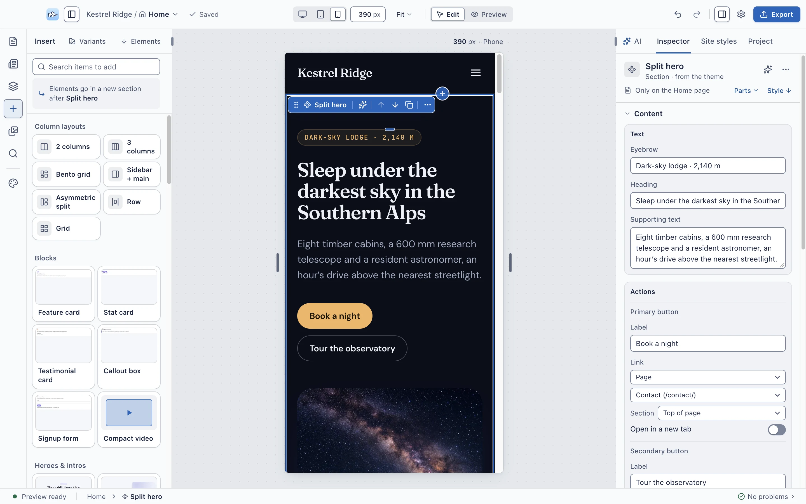
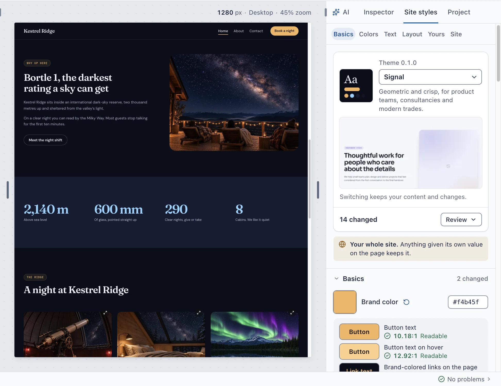
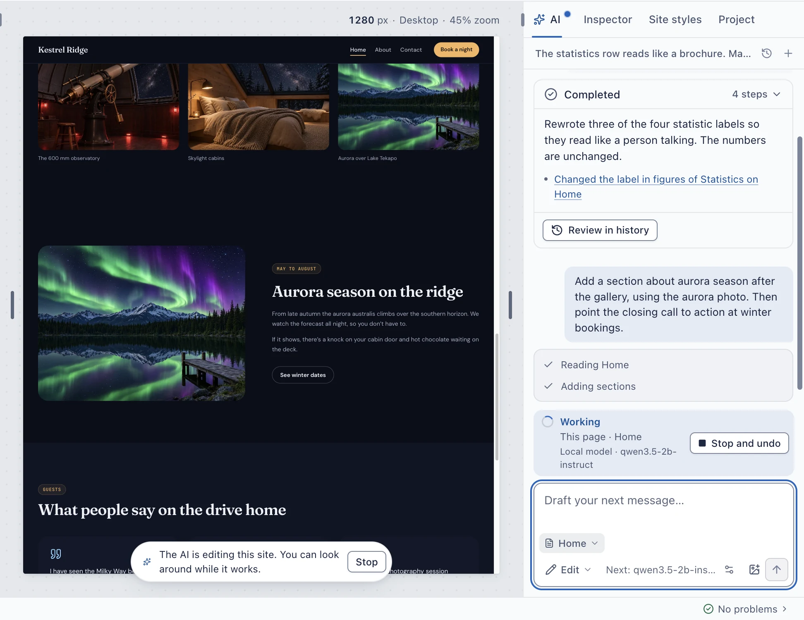
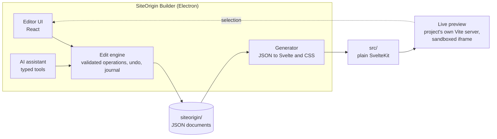

<p align="center">
  
</p>

<h1 align="center">SiteOrigin Builder</h1>

<p align="center">
  <strong>Websites you own, built visually.</strong><br>
  A free, open-source desktop editor for brochure websites, with an AI assistant that can run on your own computer.
</p>

<p align="center">
  <a href="#what-you-can-build">Features</a> ·
  <a href="#the-ai-assistant">AI assistant</a> ·
  <a href="#your-site-is-just-a-sveltekit-project">Your code</a> ·
  <a href="#future-work-a-local-first-model">Local model</a> ·
  <a href="#development">Development</a>
</p>

<p align="center">
  <picture>
    <source media="(prefers-color-scheme: dark)" srcset="docs/images/readme/editor-dark.webp">
    
  </picture>
</p>

SiteOrigin Builder is a desktop app for building brochure websites. You edit the site directly on the canvas, and you can ask an AI assistant to do the heavy lifting when that's quicker.

Every site you make is a normal SvelteKit project in a folder on your computer. You can export it, put it in git, host it anywhere or hand it to a developer. There's no account to create, no hosted database and nothing your published site depends on.

> [!NOTE]
> This is a prototype (version 0.1). It already builds real multi-page sites, but the project format will still change before 1.0. The screenshots in this README are of the real app, editing a made-up dark-sky lodge called Kestrel Ridge.

## Why it exists

Most website builders keep your site on their servers. You rent it, and if you leave, you start again.

With SiteOrigin Builder, the editor runs on your computer and writes standard SvelteKit code into your project folder. You use the app to build the site, then deploy the output wherever you want.

A few practical choices shape the editor:

- **The page stays front and centre.** The live preview gets most of the window, with sidebars for pages, layers, styles and chat around it.
- **You don't need AI.** Manual editing does everything on its own. The assistant is there when it's quicker to ask.
- **One edit path for you and the AI.** Assistant changes go through the same validation and undo history as your own edits.
- **Crash recovery is built in.** Edits are written to a journal and grouped into undo steps, so interrupted work can be recovered.

## What you can build

### Editing on the canvas

Click anything on the canvas to select it, and edit text right where it sits. The inspector shows typed controls for whatever you picked (text, links, images, icons, lists), plus layout, spacing, size, typography and appearance. Selection stays in sync across the canvas, the layers tree, the breadcrumb and the inspector.

Drag sections to reorder them, or move elements between containers in Layers. Wrap things in a stack, row or grid, turn a repeated element into a list, or save a section as a component to reuse across the site.

<p align="center">
  <picture>
    <source media="(prefers-color-scheme: dark)" srcset="docs/images/readme/phone-insert-dark.webp">
    
  </picture>
</p>

### Responsive overrides

Every page has one content tree and one set of styles, with optional overrides for phone, tablet and desktop. Switch the preview width and override only the styles that need to change at that size.

### Site-wide styles

Colours, fonts, text styles, spacing, containers, radii, shadows and borders all live in one place as site-wide tokens. Change the brand colour once and every button, link and badge follows. Contrast is checked as you go, so you can see whether button text is still readable before you ship it.

<p align="center">
  <picture>
    <source media="(prefers-color-scheme: dark)" srcset="docs/images/readme/site-styles-dark.webp">
    
  </picture>
</p>

### Three themes, one set of components

SiteOrigin Builder includes three themes built on the same component contracts, so you can switch themes without losing any of your content.

| Theme | Character |
| --- | --- |
| **Foundation** | Clean and restrained, for service businesses, studios and personal sites. |
| **Editorial** | High-contrast and typographic: a display serif, hairline rules and asymmetric columns. |
| **Signal** | Geometric and crisp, for product teams, consultancies and modern trades. |

Each theme covers more than thirty sections and blocks: heroes, service grids, galleries, carousels, pricing tables, team grids, testimonials, FAQs, data tables, video, contact forms, site search, blog layouts and more. Contact forms post to Formspree, Basin, Getform, Web3Forms or Netlify Forms, so you don't need a server.

### Pages, posts and site tools

- **Pages and posts.** Add, nest and reorder pages, set routes and SEO, and mark drafts. Posts have categories, tags, archives and an RSS feed. You can import existing posts from a WordPress export file or a folder of Markdown (Jekyll, Hugo, Eleventy and Astro front matter all work).
- **Collections.** Structured content like team members, projects or events, each with its own fields and an optional page per entry.
- **Languages.** Give a page a language and link its translations. The export declares `hreflang` alternates for you.
- **SEO and AI discovery.** A dedicated SEO view checks titles, descriptions and sharing images across the whole site. SiteOrigin Builder can also write `llms.txt`, Markdown mirrors of each page and WebMCP declarations for AI agents.
- **Assets.** Import images (with responsive copies made for you), fonts and documents. You can see where each one is used, replace it everywhere at once or clear out anything unused.
- **History and versions.** Undo survives a restart, the history is grouped into readable steps, and you can save named versions and restore any of them.
- **Find and replace, command menu, spelling.** Replace text across every page, run any action from the command menu (Cmd/Ctrl+K), and fix spelling with a right-click.

### Custom Svelte code

Turn on **Developer mode** in Settings and you can view the generated Svelte for any component, convert a component to code, or write your own Svelte components in a built-in editor with live compiler diagnostics. Before saving, the editor checks that the component compiles for browser and server, imports only allowed modules, and avoids raw HTML and `eval`. If a check fails, it blocks the save and shows you why. With an AI provider set up, a small repair agent can fix the code and run the checks again.

Developer mode is off by default, because most people building a brochure site never need it.

## The AI assistant

<p align="center">
  
</p>

The assistant uses the same validated edit operations as the visual editor, so an AI change behaves exactly like one you made by hand. Ask for something, and it reads the page, makes its changes, checks them and reports back. Each request lands as a single undo step, and you can stop and revert at any point.

It works within strict limits:

- **Scope is explicit.** If you have an element selected, the request can only change that element. Anything wider needs your approval, and the assistant asks for it.
- **Typed tools only.** It has no shell, filesystem or network access, so it can only act through the editor's own tools.
- **No image pixels go to the model.** The assistant refers to images by name and ID instead of uploading them.
- **No custom code unless Developer mode is on.** By default, the assistant works with theme components and site styles.

SiteOrigin Builder works with **OpenAI** and **Anthropic**, or with a **local model** through any OpenAI-compatible server. There are presets for llama.cpp, Ollama, LM Studio and MLX. Local servers are loopback-only unless you explicitly allow a remote address, so your site's content stays on your machine.

## Your site is just a SvelteKit project

Visual edits are saved as JSON documents under `siteorigin/`, and a generator turns them into ordinary Svelte and CSS.

```text
kestrel-ridge/
├── siteorigin.project.json     # marks the folder as a Builder project
├── siteorigin/                 # your pages, components and styles, as JSON
├── src/
│   ├── routes/                 # generated SvelteKit routes
│   └── lib/siteorigin/         # generated components and your own code components
├── static/                     # your images, plus the generated sitemap, robots.txt and llms.txt
└── .siteorigin/                # private editor state: history, chat, caches (never exported)
```

The exported site has no Builder runtime in it. You can ship it two ways:

- **Website files, ready to upload.** Every page is prerendered and checked for editor-only markup, and photo location and camera data are stripped.
- **The editable source project.** It builds with plain `npm ci && npm run build`, and the output in `build/` works on any static host. Redirect rules can be written for Cloudflare, Netlify or Vercel.

Both exports work as a folder or a ZIP file, and an exported source ZIP opens straight back up as a working project. The editor's own state lives in `.siteorigin/`, which never leaves your computer.

## How it works



- **One edit pipeline.** Manual edits and AI edits are both `EditOperation`s, checked against the same schemas and scope rules before anything is written.
- **Real preview.** The project's own Vite and SvelteKit dev server runs in an isolated utility process on loopback, so the canvas shows the actual site inside a sandboxed iframe.
- **Bundled runtime.** The app bundles its own Node runtime, npm and an offline copy of the starter project's locked packages. Creating a project takes a second or two and needs no network.

The full product and technical design is in the [v0.1 specification](docs/specification-v0.1.md).

## Future work: a local-first model

The long-term goal is a free, private website builder whose assistant runs on your own computer out of the box. Cloud models are the practical way to test full-site building right now, while we work toward that local model.

We want to ship one official model, fine-tuned for SiteOrigin Builder:

- **The base model.** We're starting with Qwen3.5-2B under Apache-2.0, trying LoRA first and moving to a full fine-tune only if LoRA plateaus. If Qwen 4 2B ships under the same licence and scores better on our eval set, we'll move to it. The licence matters: it has to let anyone use the model commercially, including fine-tunes, without a revenue cap.
- **Built for a small model from the start.** The agent already uses compact tool schemas, bounded context, deterministic validation, and grammar-constrained decoding, where every turn is one JSON object enforced token by token. Because the grammar only allows valid operations, a 2B model can handle routine editing reliably.
- **Training on the right data.** Training and evaluation use real editor operations (changing properties, inserting components, adjusting responsive styles, editing tokens) built from synthetic or explicitly contributed examples. User projects and chat transcripts are never collected.
- **Reusable training and eval sets.** The long-term work lives in the dataset and the benchmark, so moving to a better base model should mostly mean retraining and running the evals again.

We're aiming for early 2027. The plumbing is already in place: the local adapter, runtime presets, per-model capability profiles and a headless benchmark (`npm run eval:agent`, with more than fifty graded cases) that runs against both cloud and local models.

Other providers will keep working through the same adapter, but they'll be optional extras rather than the main path.

### Also on the horizon

- **SiteOrigin Hosting** for one-click publishing. Export stays the default, and you'll always be able to host your site anywhere.
- **Live collaboration.** The protocol and a relay are in progress, though there's no editor UI for it yet.
- **More themes**, installable as packs and pinned by digest.
- **Signed installers and full CI** for macOS, Windows and Linux before the first public release. See [docs/releasing.md](docs/releasing.md).

## Development

Node 24.15+ is recommended for development (22.22.2+ and 26+ also work). You don't need Node installed to run the packaged app.

```sh
npm install
npm run dev                          # the app with hot reload
npm run typecheck
npm test                             # unit and integration tests
npm run build && npm run test:e2e    # drive the built app with Playwright, headless
npm run test:export-build            # export integrity, plus a standalone build of the exported source
npm run eval:agent                   # the agent benchmark (scripted by default; --live costs money)
npm run pack                         # an unpacked app in dist/
npm run dist                         # installers: DMG, NSIS and AppImage
```

End-to-end scripts run the real app headless, so nothing pops up on your screen while they run. In development builds, `OPENAI_API_KEY` and `ANTHROPIC_API_KEY` are read from the environment when no key is saved in Settings. Packaged builds keep saved keys in `api-keys.json` in the app's data folder, readable only by your user account. The app doesn't use the OS keychain, so it never triggers a system password prompt.

[CONTRIBUTING.md](CONTRIBUTING.md) has the full test guide and the rules that keep projects safe and portable.

## Licence

SiteOrigin Builder is released under the [Apache License 2.0](LICENSE). The three built-in themes are MIT-0, so the code they generate in your site is yours to do whatever you like with.
