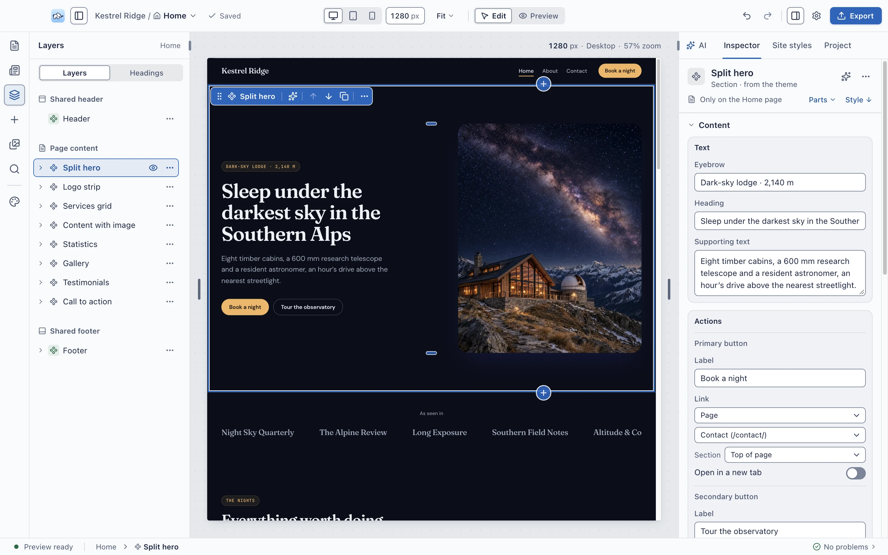
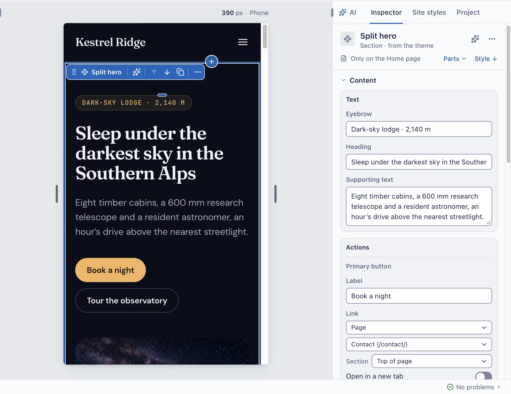
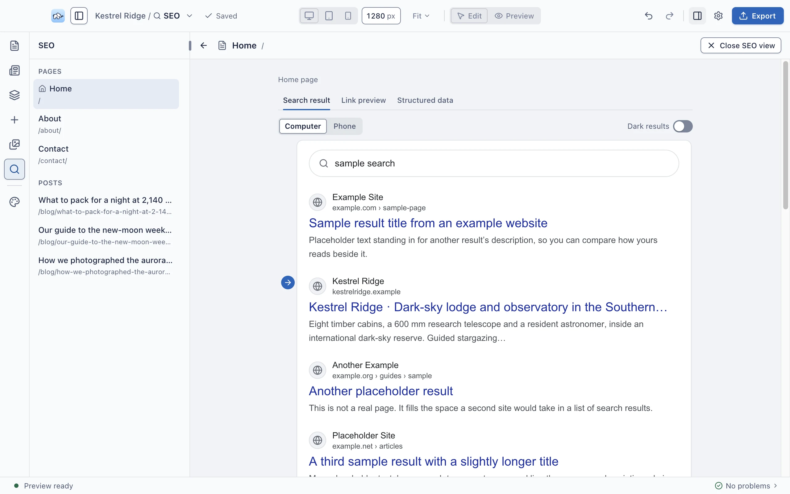
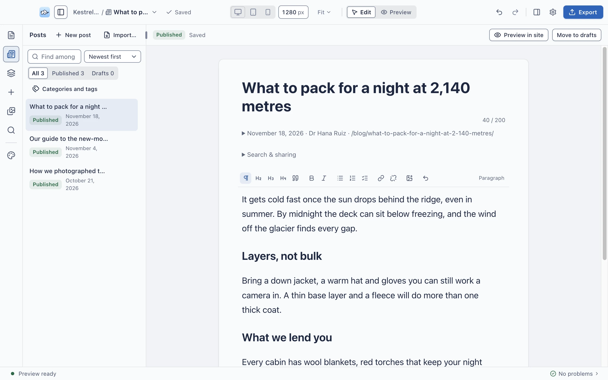
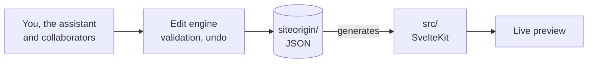

<p align="center">
  
</p>

<h1 align="center">SiteOrigin Builder</h1>

<p align="center">
  <strong>Websites you own, built visually.</strong><br>
  A free, open-source desktop editor for small and mid-sized websites, from a business site with a blog to a portfolio or a small publication. Every site is a plain SvelteKit project on your own computer.
</p>

<p align="center">
  <a href="LICENSE"></a>
  
  
</p>

<p align="center">
  <a href="#run-it-from-source">Run it from source</a> ·
  <a href="#features">Features</a> ·
  <a href="#roadmap">Roadmap</a>
</p>

<p align="center">
  <picture>
    <source media="(prefers-color-scheme: dark)" srcset="docs/images/readme/editor-dark.webp">
    
  </picture>
  <br>
  <sub>Editing the home page of Kestrel Ridge, a made-up lodge site. The selection is shared by the canvas, the layers tree and the inspector.</sub>
</p>

You edit the site directly on the canvas, and you can ask an AI assistant when that's quicker, using a cloud model or one running on your own machine. Builder also shows you how every page will look in search results and shared links, and you can invite people into a live session to watch or edit with you.

What you build is yours: a folder you can put in git, host anywhere or hand to a developer. There's no account to create, and your published site runs without Builder. It isn't meant for web apps, online stores or sites with user accounts.

> [!NOTE]
> This is a prototype (version 0.1). It already builds real multi-page sites, but the project format will still change before 1.0. The screenshots here are of the real app.

## Run it from source

Downloadable installers are planned. For now, run Builder from source with Node 24.15+ (22.22.2+ and 26+ also work).

```sh
git clone https://github.com/siteorigin/builder.git
cd builder
npm ci
npm run dev
```

When the app opens, choose **New project**, pick the Business starter and start editing. **Export** gives you the finished site. The AI assistant is optional: add a key or point it at a local model in **Settings → AI assistant**.

## Features

### Design on the canvas

Click anything on the page to select it, and edit text right where it sits. The inspector shows the controls for whatever you picked, from text, links and images to layout, spacing, typography and appearance.

- **Sections and layouts.** Insert sections, drag them into order, or wrap elements in a stack, row or grid.
- **Reusable components.** Save a section as a component, edit it everywhere at once, or make one copy unique.
- **Responsive overrides.** One page and one set of styles, with overrides for phone, tablet and desktop only where you need them.
- **History and versions.** Undo survives a restart, and you can save named versions and restore any of them.

<p align="center">
  <picture>
    <source media="(prefers-color-scheme: dark)" srcset="docs/images/readme/phone-dark.webp">
    
  </picture>
  <br>
  <sub>The same page at phone width. The content is shared, so only styles you override for phone change.</sub>
</p>

### Search and sharing

The **SEO view** takes over the canvas. It opens on an overview of every page and post and flags the ones that still need a search title, description or sharing image. Choose one and you get a realistic results page, with your own result marked among placeholder results, and it updates as you type.

- **Search results and link previews.** Computer or phone, light or dark, plus each platform's share card, so you can see where a title gets cut short or an image is missing.
- **Structured data in plain words.** What search engines are told about the page, with the raw JSON-LD tucked away.
- **Optimize with AI.** Ask the assistant to improve the chosen page's title and description.
- **Built into the export.** Every site gets `sitemap.xml`, `robots.txt` with a crawler policy and canonical links. Translated pages get `hreflang` alternates, and moved pages get redirect rules for Cloudflare, Netlify or Vercel.
- **Ready for AI agents.** Every site gets `llms.txt`, and you can turn on Markdown copies of each page and WebMCP declarations for your forms and search.

<p align="center">
  <picture>
    <source media="(prefers-color-scheme: dark)" srcset="docs/images/readme/seo-dark.webp">
    
  </picture>
  <br>
  <sub>The SEO view. The arrow marks the Kestrel Ridge result, and you can see where its title gets cut off. The other results are placeholders for comparison.</sub>
</p>

### The AI assistant

The assistant uses the same validated edit operations as the visual editor, so its changes behave exactly like yours. Ask for something and it reads the page, makes its changes, checks them and reports back. Each request lands as a single undo step.

It works within strict limits:

- **Scope is explicit.** A request scoped to the selected element (the usual scope while something is selected) can only change that element. Anything wider needs your approval, and the assistant asks for it.
- **Typed tools only.** It has no shell, filesystem or network access, so it can only act through the editor's own tools.
- **No image pixels go to the model.** It refers to images by name and ID instead of uploading them.
- **No custom code unless Developer mode is on.** By default it works with theme components and site styles.

<p align="center">
  <picture>
    <source media="(prefers-color-scheme: dark)" srcset="docs/images/readme/ai-running-dark.webp">
    
  </picture>
  <br>
  <sub>A request in progress. The new section is already on the page, and <strong>Stop and undo</strong> is one click away.</sub>
</p>

It can also set up a collection, fill it from images you drag into the chat and design its page template.

Page text and structure go to the provider you choose: **OpenAI**, **Anthropic**, or a **local model** through any OpenAI-compatible server, with presets for llama.cpp, Ollama, LM Studio and MLX. Run the model server on your own computer and the assistant's requests stay on that machine. Qwen3.5-2B, the base of our own model, has a built-in profile that knows its real context window.

### Themes and site styles

One theme, **Foundation**, ships with Builder: clean and restrained, for service businesses, studios and personal sites. A theme is a set of component contracts, so more can be added later and a site can switch between themes and keep all of its content.

Foundation covers more than thirty sections and blocks, from heroes, galleries and carousels to pricing tables, FAQs, contact forms and blog layouts. Colours, fonts, text styles, spacing, radii, shadows and borders live in **Site styles** as site-wide tokens. Change the brand colour once and every button and link that uses it follows, with contrast checked as you go.

<p align="center">
  <picture>
    <source media="(prefers-color-scheme: dark)" srcset="docs/images/readme/site-styles-dark.webp">
    
  </picture>
  <br>
  <sub>Site styles. Button text on the amber brand colour is checked at 10.18:1.</sub>
</p>

### Content: posts, collections and outside data

Builder includes an optional flat-file CMS. A site that doesn't need it stays simple.

- **Posts.** Categories, tags, archives and an RSS feed, with drafts and a writer of their own.
- **Collections.** Structured content like team members, projects or events, each with its own fields, edited in the **Content** workspace, with an optional page per entry.
- **Loops and queries.** Any section can repeat over a collection with filters, sorting and limits. It all resolves to plain Svelte at build time.
- **Outside sources.** Pull content read-only from a headless CMS like Contentful, Sanity or Strapi, a GraphQL endpoint or your own REST API, with field mapping. API tokens stay in your user folder, never in the project or the export.
- **Mapping and sync.** The assistant can write the field mapping from a sample response, and an exported project can refresh its content with `npm run sync`, in CI or on a webhook, without Builder.

<p align="center">
  <picture>
    <source media="(prefers-color-scheme: dark)" srcset="docs/images/readme/posts-dark.webp">
    
  </picture>
  <br>
  <sub>A post open in the writer. Each post gets its own page under /blog/, plus archives and a feed.</sub>
</p>

### Working together

Click **Share** and you get a link. Guests type a name in a waiting room, and you let them in. It's built for walking a client or a colleague through the site while you talk, so there's no chat.

- **Viewers.** Watch the live site in any browser, with nothing to install and no account.
- **Collaborators.** Join from their own copy of Builder and make visual edits to your project. Your computer stays the only place the project is written, and guests never see your files, settings, API keys or other projects.
- **See what each other is doing.** Selections and clicks are highlighted on the canvas, and anyone can pin a short note to a page or element. Notes stay on your machine as a checklist.
- **You stay in control.** Sessions end after a time you pick, at most 24 hours. You can let a trusted collaborator use AI, which runs on your machine with your provider, and take it back at any time.
- **An open relay.** The relay is an open-source Cloudflare Worker in this repository. It stores no project files and no accounts.

### Your site is a SvelteKit project

Visual edits are saved as JSON documents under `siteorigin/`, and a generator turns them into ordinary Svelte and CSS. The exported site has no Builder runtime in it.

```text
kestrel-ridge/
├── siteorigin.project.json   # marks a Builder project
├── siteorigin/               # pages, components, styles (JSON)
├── src/routes/               # generated SvelteKit routes
├── src/lib/siteorigin/       # generated and custom components
├── static/                   # images, sitemap, robots.txt, llms.txt
└── .siteorigin/              # private editor state, never exported
```

- **Website files, ready to upload.** Every published page is prerendered (drafts are left out) and checked for editor-only markup, and photo location and camera data are stripped.
- **The editable source project.** It builds with plain `npm ci && npm run build` on Node 22.17 or newer, and the output in `build/` works on any static host.

Both exports work as a folder or a ZIP file, and an exported source ZIP opens straight back up as a working project.

### Custom Svelte code

Turn on **Developer mode** in Settings to view the generated Svelte for any component, convert a component to code, or write your own Svelte components with live compiler diagnostics. Before saving, the editor checks that the code compiles for browser and server, imports only allowed modules, and avoids raw HTML and `eval`. If a check fails, the save is blocked and you see why.

Developer mode is off by default, because most people building a site like this never need it.

### Also included

| Area | What you get |
| --- | --- |
| **Forms** | Contact forms that post to Formspree, Basin, Getform, Web3Forms or Netlify Forms, so you don't need a server. |
| **Images and files** | Responsive copies made on import, a list of where each one is used, replace everywhere, and fonts and documents alongside. |
| **Languages** | Pages linked to their translations, with `hreflang` in the export. |
| **Imports** | Existing posts from a WordPress export file or a folder of Markdown (Jekyll, Hugo, Eleventy and Astro front matter). |
| **Project health** | Broken links, missing images and search readiness, flagged before you export. |
| **Everyday tools** | Find and replace across pages, a command menu (Cmd/Ctrl+K) and right-click spelling suggestions. |
| **The export itself** | A README with hosting notes for your host, a not-found page, a favicon and an RSS feed with a description for every post. |

## Roadmap

### A local-first model

The long-term goal is a free, private website builder whose assistant runs on your own computer out of the box. Cloud models are the practical way to test full-site building today, and we're aiming to ship our own local model in early 2027.

- **One official model.** We're starting with Qwen3.5-2B under Apache-2.0, fine-tuned for Builder with LoRA first and a full fine-tune only if LoRA plateaus. If Qwen 4 2B ships under the same licence and scores better on our eval set, we'll move to it. The licence has to let anyone use the model commercially, fine-tunes included, without a revenue cap.
- **Built for a small model.** The agent already uses compact tool schemas, bounded context and grammar-constrained decoding. The grammar keeps every reply in a valid shape, the editor checks every edit, and the benchmark measures how often a model actually finishes the job.
- **Trained on the right data.** Training and evaluation use real editor operations, built from synthetic or explicitly contributed examples. User projects and chat transcripts are never collected.

Other providers will keep working through the same adapter, as optional extras rather than the main path.

### Also planned

- **SiteOrigin Hosting** for one-click publishing. Export stays the default, and you can always host anywhere.
- **More themes**, installable as packs, and the component library in its own repository.
- **Installers** for macOS, Windows and Linux, signed and notarized on macOS. See the [release checklist](docs/releasing.md).

## Development

The [contributor guide](CONTRIBUTING.md) has the full test setup and house rules, and the [v0.1 specification](docs/specification-v0.1.md) records the original design decisions; where they differ (it plans one theme, for example), this README describes what ships. Development uses the same Node as above; the packaged app bundles its own. Some unit tests and the packaging commands also need Playwright's Chromium: `npx playwright install chromium` (on Linux add `--with-deps`; see [CONTRIBUTING.md](CONTRIBUTING.md#setup)).

```sh
npm run dev                  # the app with hot reload
npm run typecheck
npm test                     # unit and integration tests
npm run build
npm run test:e2e             # the built app, driven headless
npm run eval:agent           # agent benchmark (--live costs money)
npm run dist                 # installers: DMG, NSIS, AppImage
```

End-to-end scripts run the real app headless, so nothing pops up while they run. `npm run test:packaged` clears the folder `WORK` points at before it starts, so point `WORK` only at a disposable folder, or leave it unset. In development builds, `OPENAI_API_KEY` and `ANTHROPIC_API_KEY` are read from the environment when no key is saved. Saved keys live in `api-keys.json` in the app's data folder, readable only by your user account on macOS and Linux (on Windows the data folder's permissions apply). The app doesn't use the OS keychain, so it never triggers a system password prompt.

### How it works

Manual edits, assistant edits and collaborators' edits all go through one edit engine, which validates them and writes the project's JSON documents. A generator turns those documents into plain SvelteKit, and the project's own dev server shows it in the canvas.



- **One edit pipeline.** Every change is an `EditOperation`, checked against the same schemas and scope rules before anything is written.
- **Real preview.** The project's own Vite and SvelteKit dev server runs in an isolated utility process on loopback, so the canvas shows the actual site.
- **Bundled runtime.** The packaged app ships its own Node, npm and an offline copy of the starter's locked packages for its platform, so creating a project can set up its website tools with no network. The exception is macOS, where the first project downloads the build tools' native parts (Rolldown, Lightning CSS and fsevents): Apple's notarization rejects them inside the app because they aren't signed with its Developer ID. Setup downloads anything the copies on this computer lack, and says so first.

## Licence

SiteOrigin Builder is released under the [Apache License 2.0](LICENSE). The three built-in themes are MIT-0, so the code they generate in your site is yours to do whatever you like with. Icons are from Lucide (ISC). The bundled fonts (DM Sans, Fraunces, Inter, JetBrains Mono, Lora, Playfair Display, Plus Jakarta Sans, Sora and Space Grotesk) are under the SIL Open Font License 1.1. The starter sample images are original, and free to use, modify and redistribute in websites built with SiteOrigin Builder (see `resources/starter-assets/NOTICE.md`).
