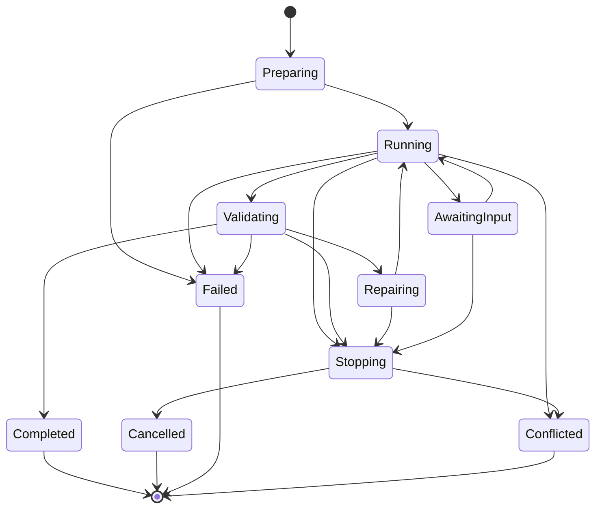
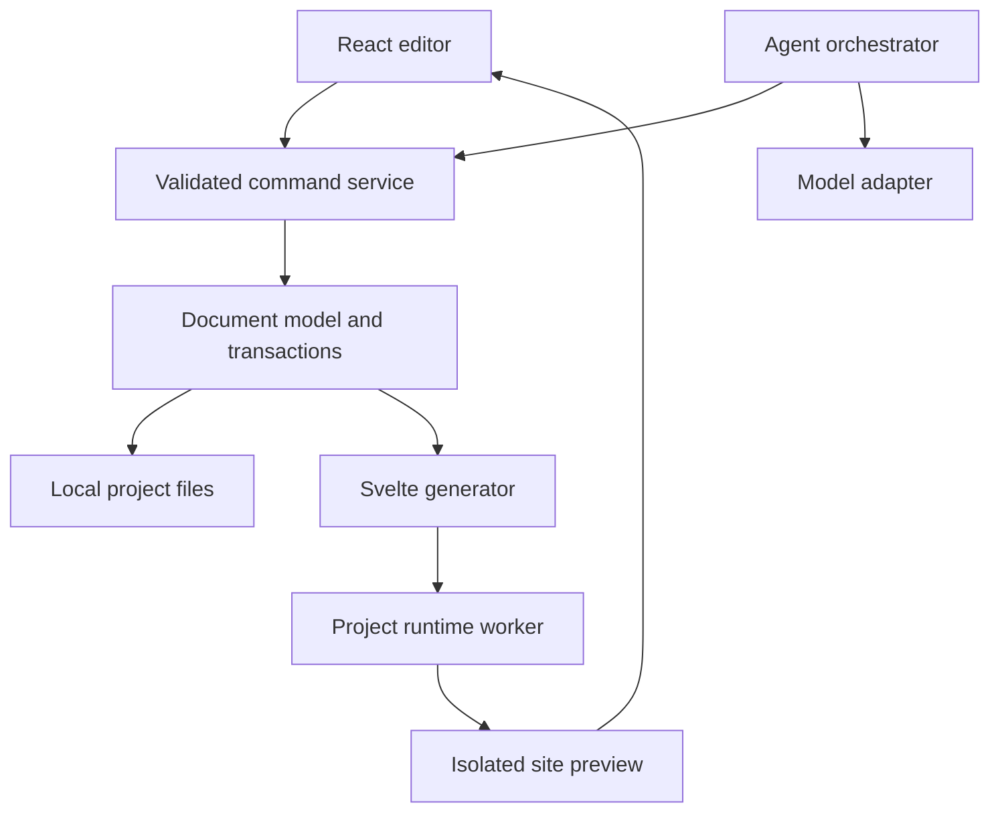

# Site Origin Builder

## Initial version: product and technical specification

**Version:** 0.1 specification draft  
**Date:** 23 November 2026  
**Status:** Proposed implementation specification  
**Product:** Free, open-source desktop application for creating brochure websites  
**Application:** Electron, React and TypeScript  
**Website output:** A normal, local SvelteKit project with portable source and static build output

## How to use this specification

This document defines the first version that someone can use to create, edit, preview and export a small business website. It includes the product experience, implementation boundaries, data contracts, AI workflow, delivery sequence and acceptance criteria.

**MUST** identifies a release requirement. **SHOULD** identifies a desirable refinement that can follow the first working release. **Later** identifies an intentional extension point, not work required for version 0.1. Recommendations and numeric targets are design decisions, not claims about an existing implementation. Technical references appear at the end.

The immediate objective is a usable editor with a coherent foundation. The initial release does not need a large catalogue, trained local models or a hosting business to demonstrate its value.

### Decisions changed during implementation

The v0.1 implementation deliberately departs from this draft in four places. The sections concerned have been updated to match, and each is marked *(changed in implementation)*.

| Area | Draft | Implementation | Sections |
| --- | --- | --- | --- |
| First AI provider | Anthropic first, OpenAI next. | OpenAI is the default provider, through the Responses API with GPT-6.2 Sol (`gpt-6.2-sol`) as the default model; the Anthropic adapter ships beside it behind the same contract. | §2.1, §25.2 |
| Stored API keys | OS-backed protection (`safeStorage`), session-only on Linux without a secret backend. | A plain `api-keys.json` in the app's data folder, written with mode `0600` (user-only) on macOS and Linux; on Windows the data folder's permissions apply. The OS keychain is never used, so users never see keychain access prompts. | §21.4, I10 |
| Source editor | Monaco. | CodeMirror 6 with Svelte language support and live compiler diagnostics: much smaller, and enough for project code components. | §15.1 |
| Catalogue location | A separate `siteorigin-builder-components` repository. | v0.1 bundles the Foundation theme from this repository (`src/catalogue/`, written in a small TypeScript DSL). A separate component repository and its build are future targets. | §9.1, §23 |

## Contents

| Area | Sections |
| --- | --- |
| Product | [Definition](#1-product-definition), [Scope](#2-scope-and-release-boundaries), [User journeys](#3-core-user-journeys). |
| Visual editor | [Workspace](#4-workspace-and-interface), [Selection and inspector](#5-selection-and-inspector-behavior), [Pages](#6-pages-navigation-and-site-settings), [Responsive design and tokens](#7-responsive-design-and-site-tokens). |
| Building blocks | [Components](#8-components-and-the-initial-catalogue), [Themes and repositories](#9-themes-and-the-secondary-repository), [Assets](#10-assets-and-content-handling). |
| AI | [Chat](#11-ai-chat-experience), [Agent lifecycle](#12-agent-architecture-and-lifecycle), [Tools](#13-tools-and-edit-commands), [Context without vision](#14-context-and-validation-without-vision). |
| Implementation | [Architecture](#15-application-architecture), [Project format](#16-project-format-and-source-of-truth), [Generation and preview](#17-generation-and-preview-integration), [Transactions](#18-transactions-undo-and-recovery). |
| Operation | [Project lifecycle](#19-project-lifecycle-and-local-runtime), [Export](#20-export-and-standalone-operation), [Trust and privacy](#21-trust-privacy-and-application-boundaries). |
| Delivery | [Quality targets](#22-quality-accessibility-and-performance), [Implementation stages](#23-implementation-sequence-and-gates), [Acceptance tests](#24-acceptance-and-regression-plan), [Future models and defaults](#25-future-local-models-and-decisions-retained), [References](#26-technical-references). |

---

## 1. Product definition

Site Origin Builder is a desktop website editor for people who want to assemble and customize a polished brochure website, with optional AI assistance. The website remains the main workspace. Users can select content, adjust layout and appearance, manage pages, create reusable components and ask an agent to make changes.

The editor creates a real SvelteKit project on the user's computer. Users own that project and can inspect its files, export it, place it under version control or deploy it independently. The editor must not become a production dependency of the published website.

The initial audience includes existing SiteOrigin page-builder users, freelancers and small business owners who understand pages, sections and reusable blocks. The interface should use those concepts before exposing framework terminology. This is a new application and project format. There is no WordPress import, old-builder conversion or compatibility layer in this release.

### 1.1 The essential promise

> Start with a cohesive set of components, make the website your own through direct editing and short AI requests, and keep a complete SvelteKit project that you can take anywhere.

### 1.2 Product principles

1. **The website is the workspace.** The preview receives most of the window. Panels support the selected task.
2. **Manual editing is complete enough to be useful by itself.** Connecting an AI provider is optional.
3. **AI uses the same editing operations as the interface.** A change made by chat should behave like the equivalent manual change.
4. **Local project ownership is fundamental.** No application account or hosted project database is required.
5. **Components form a coherent system.** Good defaults, shared tokens and predictable responsive behavior matter more than catalogue size.
6. **Changes have understandable scope.** Users can distinguish this instance, a shared component and the whole site.
7. **Source access remains available.** Visual editing has a clear contract; custom Svelte source provides the advanced escape hatch.
8. **An agent finishes work.** It can inspect, make several changes, validate, repair and report the result.
9. **The architecture accommodates smaller local models.** Most routine actions are constrained operations on structured data.
10. **Failures preserve the project.** Undo, checkpoints and recoverable writes are part of the first version.

### 1.3 What counts as a successful first release

A user can create a five-page business website, replace the sample content and images, adjust the brand styles, customize mobile layouts, create a reusable component, ask the AI to add and refine sections, close and reopen the project, and export a working static website.

That flow must work without opening a terminal. Manual editing and export must continue to work when the AI provider is unavailable. Cloud AI in version 0.1 requires network access and user-supplied credentials; the future local-model experience is a separate milestone.

---

## 2. Scope and release boundaries

### 2.1 Required in version 0.1

| Area | Required behavior |
| --- | --- |
| Desktop application | Electron app with React UI, native file dialogs, project recents and System/Light/Dark appearance. |
| Project creation | Bundled SvelteKit starter; choose project name, folder and starter content; create a complete local project. |
| Project lifecycle | Open a compatible Builder project, save automatically, reopen, duplicate and recover interrupted edits. |
| Workspace | Central website preview, left navigation/library, right inspector/chat dock, top toolbar and compact diagnostics. |
| Pages | Create, rename, duplicate, reorder and delete; edit routes and basic SEO settings. |
| Direct editing | Select managed elements; change text, images, links, component properties, layout, typography and appearance. |
| Responsive editing | One content tree, three defined style ranges, resizable preview and explicit overrides. |
| Components | Browse, insert, reorder, duplicate, edit shared definitions, make unique and create project components. |
| Advanced source | View generated source; create/edit custom Svelte code components with declared properties. |
| Site styles | Semantic colors, text styles, spacing, containers, borders, radii and shadows. |
| Theme system | One complete built-in theme, stable component contracts and a tested theme-resolution mechanism. |
| Assets | Import local images and approved fonts; choose, replace, inspect usage and remove unused assets. |
| AI | Streaming chat, explicit selection context, multi-step tools, cancellation, validation, repair and undo of a turn. |
| Providers | A real hosted provider implementation, with an adapter contract for Anthropic, OpenAI and future local providers. |
| Export | Complete source project and static website build, with no application account or runtime service required. |
| Reliability | Persistent edit history, grouped undo, conflict detection, schema validation and useful error recovery. |

**Provider implementation default** *(changed in implementation)*: OpenAI is the default provider for the first end-to-end implementation (Responses API, default model GPT-6.2 Sol, `gpt-6.2-sol`), and the Anthropic adapter ships in the same release behind the same adapter contract. Support for both is not a prerequisite for a usable build. Every provider shown as available in the UI must work; unavailable adapters are not selectable placeholders. No particular model identifier is hard-coded into the project format.

### 2.2 Deliberately outside version 0.1

| Capability | Boundary |
| --- | --- |
| WordPress or other builder migration | No importer or automatic conversion. |
| Arbitrary existing SvelteKit import | Open projects created by this application or explicitly conforming to its format. General source-to-visual import comes later. |
| Vision | No screenshots or images sent to the model; no visual understanding claims. |
| Bundled trained local AI | Provide architectural support; model selection, training, weights and hardware tuning come later. |
| Large theme catalogue | Ship one complete theme. Use a development fixture to exercise compatibility. |
| Hosted publishing | Export is the release requirement. Hosting accounts, billing, domains and deployment integrations are later work. |
| CMS and application backends | No collections service, authentication, database, ecommerce or server actions. |
| Collaboration | One local writer per project; no live multi-user editing or cloud synchronization. |
| Full design suite | No infinite canvas, vector drawing, animation timeline or arbitrary absolute-position layout tools. |
| General coding environment | No terminal, extension marketplace, unrestricted shell agent or general repository coding assistant. |
| Advanced content tools | No localization system, blog engine, complex rich-text editor or built-in image generation. |

These boundaries apply to supported editor features. A user can still take the exported SvelteKit source into their own development workflow.

---

## 3. Core user journeys

### 3.1 Create a first website

1. Launch the app and choose **New project**.
2. Enter a name and choose a local folder. The location is explicit and can be opened in the file manager later.
3. Choose **Business starter** or **Blank site**. The initial theme is selected automatically because only one is bundled.
4. Create the project. Show concrete progress: preparing files, preparing dependencies, starting preview.
5. Open the editor on Home. Display a complete starter page immediately once the preview is ready.
6. Select the hero heading, edit its copy and change a brand color.
7. Add a Services page and insert a services grid.
8. Switch to phone preview and make a spacing override.
9. Export a static build or the complete source project.

The Business starter contains Home, About and Contact with shared navigation/footer. It uses clearly fictional content and replaceable assets. The Blank site contains Home with a minimal section, without forcing the user to reconstruct the basic document shell.

### 3.2 Make a targeted AI edit

1. Select a heading and choose **Ask AI about this**.
2. The chat composer shows the page and selected heading as context chips.
3. Enter: “Make this headline shorter and more confident.”
4. The agent reads the selection, changes the bound text, validates the result and reports one concise sentence.
5. The turn offers **Show changes** and **Undo turn**.

The rest of the page must remain unchanged. Selecting something else while the agent runs must not retarget the submitted request.

### 3.3 Complete a multi-step request

1. Enter: “Add a services page with three service cards, link it from the header, and add a contact call to action at the bottom.”
2. The agent inspects pages, shared navigation and available components.
3. It creates the page, installs required components, sets content and adds the internal navigation link.
4. It checks routes, content references, compilation and supported responsive diagnostics.
5. It repairs an introduced issue if needed and commits the successful turn as one history group.
6. The result links directly to the new page and lists the changes.

This is one user request with several tools. The user should not need to approve every ordinary reversible edit or repeatedly ask the agent to continue.

### 3.4 Create and reuse a component

1. Build a small section using containers, text, images and buttons.
2. Select its root and choose **Create component**.
3. Give it a name. The editor replaces that subtree with an instance of a new project component.
4. Content fields receive generated property controls. An advanced schema editor can refine the controls.
5. Insert another instance and change its copy.
6. Choose **Edit definition** to change the shared spacing, then return to the page.

The two instances keep their individual content. Shared structure and default styles update together.

---

## 4. Workspace and interface

### 4.1 Main layout

| Region | Contents | Starting dimensions |
| --- | --- | --- |
| Top toolbar | Project/page name, save state, undo/redo, viewport, zoom, Edit/Preview, Export | Approximately 48–56 px high. |
| Left sidebar | Pages, Layers, Insert and Assets; entry to Site styles | Approximately 240 px; resizable and collapsible. |
| Center | One live page, canvas background, selection overlays and insertion markers | Takes all remaining space. |
| Right dock | Inspector and AI chat tabs | Approximately 360 px; resizable and collapsible. |
| Status area | Preview state, errors and current selection breadcrumb | Compact; expands only when requested. |

The inspector and chat share the right dock by default. At wide window sizes, an optional vertical split may show both without adding another column. The central page must remain useful at a 1280 × 800 application window; collapse panels when needed rather than clipping controls. A 1440 px or wider display is the preferred design target, not a requirement.

Switching tabs preserves scroll positions, inspector expansion state, chat draft and selection. Hide controls irrelevant to the current selection. Keep framework paths and build logs inside the advanced view or diagnostics.

### 4.2 Left sidebar

**Pages:** page list, current page indicator, Home badge, Add page and context menu. Reordering controls navigation order only when the shared navigation is configured to follow the page list; otherwise navigation items are explicit.

**Layers:** a semantic tree of the current page and its shared header/footer. It includes names, component badges, visibility state and nested editable parts. Users can rename layers, select, reorder and reach hidden elements through the tree.

**Insert:** searchable component catalogue with categories and thumbnails. Separate **Theme components** and **Project components**. Search indexes names, descriptions and tags. Inserting uses the current valid container or offers a clear before/after section target.

**Assets:** local project images/fonts, usage counts, import, replace and remove-unused controls. Asset metadata belongs to the project.

**Site styles:** opens token editing in the right dock while leaving the website visible. An explicit “Site-wide” label communicates the scope.

### 4.3 Canvas modes

**Edit mode** intercepts clicks to select elements. Links do not navigate and form submissions do not occur. Dragging managed handles reorders content; it does not create absolute coordinates.

**Preview mode** allows normal website interactions, including navigation, mobile menus and accordions. Selection overlays disappear. The toolbar retains an obvious return-to-edit control.

Changing mode preserves page, viewport width and scroll position where possible. Navigation in Preview updates the current-page state only after resolving a known project route. External links require a deliberate user interaction and open outside the editor through a validated URL action.

### 4.4 Canvas controls

- Desktop, tablet and phone presets; numeric viewport width; drag-to-resize handle.
- Fit to available width, 100% and common zoom values.
- Scroll to selected element and reveal selected layer.
- Visible pending/ready/error preview state.
- A single active viewport in version 0.1.

Viewport width changes the iframe's actual CSS layout viewport. Zoom only changes its display scale. At 50% zoom, a 1280 px page still runs desktop media queries. Overlay coordinates must account for iframe position, scroll and zoom.

### 4.5 Keyboard and interaction basics

| Action | Default shortcut or behavior |
| --- | --- |
| Undo / redo | Standard platform shortcuts; text editing receives its own undo while focused. |
| Save | Flush pending local changes and show save status. |
| Duplicate selected node | Cmd/Ctrl+D outside text inputs. |
| Wrap in Stack / Ungroup | Cmd/Ctrl+G wraps the selected node, or sibling layers selected together with nothing between them, in a new Stack where they are; Cmd/Ctrl+Shift+G ungroups a plain container, putting what it holds in its place. Wrap in Row and Wrap in Grid are in the Canvas, Layers and Inspector menus. Each is one history entry. |
| Delete | Delete/Backspace outside text inputs; preserve a history entry. |
| Exit current interaction | Escape exits text editing, then nested selection/component mode as appropriate. |
| Command menu | Cmd/Ctrl+K for pages, insert actions and editor commands. |
| Open AI for selection | Context action plus an assignable shortcut. |
| Reorder without dragging | Accessible move up/down actions in layer context menu. |

Multi-selection, cross-project clipboard and complex canvas gesture systems can follow later. Version 0.1 supports one selected element or subtree at a time.

---

## 5. Selection and inspector behavior

### 5.1 One selection model

Canvas, layer tree, inspector, breadcrumb and chat context MUST share the same stable selection reference. A CSS selector, source line number or transient DOM position is not a durable identity.

Default interaction:

1. Clicking a component selects its instance boundary.
2. Clicking an editable part of an already selected instance selects that part; a modifier-click can select it directly.
3. Double-clicking supported text enters inline text editing.
4. The layer tree and breadcrumb provide an alternative way to reach every managed part.
5. Escape exits text editing before changing selection.
6. Empty page space selects page settings; canvas background clears element selection.

Shared component definition editing always uses an explicit **Edit definition** action. Double-click must not ambiguously mean both editing text and changing every instance.

### 5.2 Inspector groups

| Group | Supported controls |
| --- | --- |
| Content | Plain/rich text, image, alt text, link, button label, icon and typed list items. |
| Layout | Vertical/horizontal stack, grid columns, alignment, distribution, wrap, gap and padding. |
| Size | Fill, fit content, fixed size, min/max width, aspect ratio and image fit. |
| Typography | Text style token, font family/weight, size, line height, letter spacing and alignment. |
| Appearance | Foreground/background tokens or explicit values, border, radius, shadow and opacity. |
| Transform and motion | Bounded shift on each axis, scale, rotation and its origin, and a transition preset with duration and easing. Transitions stay subject to the theme's reduced-motion rule. |
| Visibility | Visible or hidden at a defined responsive scope. |
| Semantics | Heading level, accessible label, image purpose, anchor ID and link behavior. |
| Component | Exposed properties, declared variant, edit definition, make unique and reset overrides. |
| Advanced | Source view, component schema, diagnostic identity and supported custom CSS. |

Use clear labels such as “Fill”, “Fit content”, “Gap” and “Padding”. Numeric inputs must handle valid units deliberately; arbitrary expressions belong in the advanced source path. Display a token link and an override marker separately.

### 5.3 Text editing

Inline text editing supports headings, paragraphs, button labels and bound text fields. Basic rich text supports emphasis, strong text and links through a structured representation. It does not accept unrestricted HTML.

Typing updates a local draft immediately. Coalesce a focused text-edit session into one history item; blur or a commit command flushes the edit. Preserve selection/caret and IME composition. Escape cancels the uncommitted draft. Do not regenerate the focused DOM node on every keystroke.

For text generated from a typed list, edit the corresponding item by stable item ID. Never edit the first list item merely because it has the same CSS class as the selected item.

### 5.4 Layout and drag behavior

The supported visual layout model is document flow with containers, stacks and grids. Reorder sibling sections or children, move nodes between compatible containers and insert into declared slots. Show a precise insertion indicator before accepting a drop.

Reject cycles, invalid slot contents and cross-definition moves that would change scope unexpectedly. Provide equivalent move actions for keyboard users. Hidden nodes remain editable through the layer tree.

Absolute positioning, transforms beyond the typed shift, scale and rotate controls, custom animation and complex CSS remain available through custom code, but do not receive a general visual manipulation system in this release.

### 5.5 Scope of an edit

| Scope | Effect | Required UI |
| --- | --- | --- |
| This instance | Content or supported style override for one placement | “This instance” label and reset controls. |
| Shared component definition | Structure/defaults for every instance of that definition | Dedicated mode, component name, affected-use count and exit action. |
| Shared header/footer | A shared site instance reused by pages | “Shared header/footer” label and affected-page count. |
| Site styles | Token change across all linked uses | “Site-wide” label and usage view. |

Ordinary text editing does not change a component definition. Editing declared slot contents or typed list items is an ordinary instance operation. Changing the definition's internal structure for only one placement uses **Make unique**, creating a project component and rebinding that instance. Do not detach or fork silently.

---

## 6. Pages, navigation and site settings

### 6.1 Page model

Every page has a stable ID independent of its title and path. The page record includes display name, route, navigation label, layout choice, SEO fields and a managed content tree.

Version 0.1 supports static routes such as `/`, `/about/` and `/services/design/`. Validate uniqueness after normalization and account for case-insensitive filesystems. Disallow reserved framework paths, traversal and dynamic route syntax through the normal page UI.

One page is Home. A user deleting Home must choose a replacement or leave a new blank Home page. Renaming a route must update all internal links because links store page IDs, not only URL strings. Warn about references when deleting a page and let the user choose their replacement target.

### 6.2 Shared site shell

Store header and footer as shared site instances. Each page shows or hides the shared header and the shared footer independently (`showHeader`, `showFooter`), so a landing page can keep the footer without the menu. Editing navigation content changes the shared instance across participating pages; it does not require editing the component's structural definition.

The header includes a working accessible mobile menu. Navigation items can point to a page, an anchor, an HTTPS URL, an email address or a telephone number. Keep email/telephone links distinct from ordinary web URLs.

### 6.3 Site and page settings

| Scope | Fields |
| --- | --- |
| Site | Name, default language, favicon, default description, social image, optional public base URL and default shell. |
| Page | Browser title, meta description, social image override, index/noindex setting, route, and whether it shows the shared header and the shared footer. |
| Links | Page reference, anchor, external destination, new-tab behavior and accessible label when needed. |

Generate title/meta tags, canonical URLs when a base URL is known, and a sitemap/robots file from the explicit page inventory. Do not invent a production domain. Export without a configured base URL should explain which absolute metadata is omitted.

### 6.4 Contact functionality

The included Contact section supports email, telephone, address and calls to action. Version 0.1 does not require a form backend. Do not ship a form that displays a successful submission without actually delivering anything.

A later endpoint-based form component can be added under a separately defined delivery, privacy and error-handling contract. Its absence must not prevent producing a useful Contact page now.

---

## 7. Responsive design and site tokens

### 7.1 Responsive contract

Use one content tree. Responsive changes alter styles; they do not duplicate pages or create independent copies of the content. Structural variants are selected for the whole instance. A variant may be responsive only when its contract explicitly declares it style-only with identical structure and bindings.

| Style scope | CSS range | Default preview preset |
| --- | --- | --- |
| All sizes / base | All widths | No dedicated preset. |
| Phone | Width below 768 px | Phone: 390 px. |
| Tablet | Width at least 768 px and below 1024 px | Tablet: 834 px. |
| Desktop | Width at least 1024 px | Desktop: 1280 px. |

These are product defaults. Version 0.1 keeps the thresholds fixed to simplify component compatibility. Custom breakpoints can follow later. Continuous preview widths from 320 to 1920 px MUST be supported; narrower or wider custom values MAY be available in the advanced width control.

The inspector has an explicit style scope: **All sizes**, **Phone**, **Tablet**, or **Desktop**. It defaults to All sizes. Switching preview width does not silently change edit scope. A shortcut such as **Override at this size** selects the corresponding named range. Named ranges are exclusive, so a phone-only padding edit leaves tablet and desktop unchanged.

Resolve each style source as base plus the override for the one active range. For a given property, definition defaults are overridden by the selected variant and then by instance overrides. An instance's All sizes override intentionally applies at every width unless that instance has a range-specific override. Phone values do not cascade into tablet or desktop. Emit nonoverlapping media queries and show the resolved value and its source.

Text, links and image references are shared across sizes. Alternate content by breakpoint is outside the normal editor contract. Reset removes the override; it does not write a duplicated inherited value.

**Container widths.** A box can be a query container (`containerType: inline-size`, written as `container-type: inline-size`): a page's columns, or the box around a design's slot, by the author's choice. Style rules can then target the width of the nearest query container around an element instead of the screen: `cq-narrow` (under 480 px), `cq-medium` (480 px to under 720 px) and `cq-wide` (720 px and over), stored beside the screen sizes and combinable with states (`cq-narrow:hover`). They are written as plain `@container` rules after every screen size's rules of the same layer, so a container range beats a screen size there and a stronger layer still beats both; without a query container around the element none of them applies. They never set `hidden`: visibility stays with the screen sizes, and a container layout never shows what a screen size hides, in its own layer or a weaker one (a placement's container layout keeps the design's phone hide). So one card placed in a wide 2fr column and in a narrow 1fr sidebar stays side by side in the first and stacks in the second at one desktop width, with no script. A query container's own width never comes from its content, so it belongs on a box its parent sizes (a grid column, a stretched stack); validation warns when one sits where it would shrink to nothing.

### 7.2 Token categories

| Category | Initial examples |
| --- | --- |
| Colors | Background, surface, primary text, muted text, brand, on-brand, border and focus. |
| Typography | Body family, display family, body text, small text and heading styles. |
| Spacing | A short named scale used for gaps and padding. |
| Containers | Reading width, content width and page gutters. |
| Radius | Small, medium, large and pill. |
| Borders/shadows | Standard border and a small elevation scale. |

Tokens have stable IDs, readable labels, typed values and usage information. A color can reference another color token only if the dependency graph is valid and acyclic. Prevent removal of a used token without a replacement or deliberate conversion of its usages to explicit values.

Theme defaults and project overrides are stored separately. Changing a theme must not silently erase a user's explicit token overrides. Provide **Use theme defaults** as a deliberate reset action.

### 7.3 Three separate appearance concepts

**Application appearance** changes the Electron interface: System, Light or Dark. It is a user preference and never changes website output.

**Website styling** is controlled by project tokens and components. A dark editor can display and edit a light website. A dark website is made by changing its tokens. A website can also give its visitors a dark palette beside the light one (`colorSchemeMode` in `tokens.json`): `single` (the default) emits the one `:root` palette and nothing else; `system` adds the dark palette's colors in `tokens.css` under `@media screen and (prefers-color-scheme: dark)`; `toggle` adds the same under `[data-so-theme]` and a visitor-facing Light/Dark switch in the shared header whose choice the browser remembers, applied in the page head before first paint. The dark palette is made from the light one when first turned on, its colors are edited and contrast-checked in Site styles, and print always uses the light palette. The canvas can preview either palette without reference to the application's appearance.

**Theme pack** means a coherent implementation of the common component catalogue, its tokens, defaults and AI guidance. Theme packs are not the same thing as the application's light/dark preference.

---

## 8. Components and the initial catalogue

### 8.1 Two supported component kinds

**Managed components** have an editable structured definition, property schema, slots and variants. The editor generates ordinary Svelte source from that definition. Their supported internal elements remain directly editable through the canvas and layer tree.

**Code components** have hand-authored Svelte source plus a manifest describing editable properties and any supported named parts. They can use normal Svelte behavior. Their arbitrary internals are not automatically reversible into a managed definition.

Both kinds can be placed on pages and composed inside managed components. Both use stable component identities and declared dependencies. Built-in brochure sections should be managed components wherever possible. Small reviewed code leaves provide behavior such as mobile navigation and accordions.

### 8.2 Initial theme catalogue

The initial theme is provisionally named **Foundation**. Its aesthetic is clean, restrained and suitable for service businesses, personal sites and small company websites. Use one consistent typography, spacing, radius and color system.

Ship these 18 section/component families, with one good default and a few useful variants where indicated:

| Family | Minimum contents |
| --- | --- |
| Header | Logo/name, navigation, optional action, working mobile menu. |
| Footer | Site identity, link groups and simple copyright content. |
| Centered hero | Heading, supporting copy and primary/secondary actions. |
| Split hero | Text/media layout, reversible media placement. |
| Page introduction | Compact title and description for inner pages. |
| Logo strip | A typed list of logos with meaningful alt handling. |
| Services/features grid | Repeatable cards with title, description, optional icon/link. |
| Content/media split | Image and text, with optional action. |
| Text section | Reading-width text with supported rich content. |
| Statistics | Repeatable value/label entries. |
| Testimonials | Repeatable quotes, attribution and optional portrait. |
| Team | Repeatable people, roles and portraits. |
| Pricing | Simple static plans and calls to action; no checkout. |
| FAQ | Repeatable questions and working accessible disclosure behavior. |
| Gallery | Responsive image grid; no required carousel. |
| Call to action | Heading, short copy and action. |
| Contact details | Email, phone, address and action links. |
| Section/container | Flexible empty composition with width and spacing controls. |

Also provide basic primitives: container, stack, grid, heading, paragraph, image, link/button, icon and divider. A component's displayed preview must come from its real implementation or a checked build, not unrelated artwork.

### 8.3 Required component metadata

Each component declares a stable logical ID, version, display name, description, category, tags, kind, prop schema/defaults, variants, slots, semantic editable parts, dependencies and license/provenance. It includes representative examples for both users and AI context.

Properties support string, structured rich text, number, boolean, enum, link, image, token reference, object and bounded array types. Arrays carry stable item IDs. Schema validation must enforce ranges, required fields and allowed enums.

The manifest is static data. Loading it must not execute JavaScript or load a package hook.

### 8.4 Create, duplicate and make unique

**Create component from selection:** package a selected subtree as a project component, generate sensible content properties and replace the selection with an instance. Preserve appearance and references exactly.

**Duplicate component:** copy a definition under a new project component ID. Existing placements remain bound to the original.

**Make unique:** copy the complete definition, bindings, all responsive rules and variants into a project component; preserve the selected instance's current variant and overrides, then rebind only that placement. Retain token references. Never bake only the current viewport's computed CSS into the new definition. Record provenance without keeping it subject to automatic theme replacement.

**Edit definition:** enter an explicit component workspace using sample props. Changes apply to every instance except where an instance has its own override. Property removal or type changes require a usage-aware migration; version 0.1 may reject incompatible changes and offer a fork instead.

On the first shared edit of a theme-owned definition, create a project-owned fork and rebind all existing uses in the displayed scope to it. Show this ownership change and the affected-use count in the component-editing mode before applying changes. Preserve the original catalogue definition for future insertion. Further edits operate on the project-owned definition, which future theme switches leave intact.

Create component, Make unique and Convert a copy to code must preserve appearance and behavior at every supported responsive range, including bindings, slot content and selected variants.

### 8.5 Source access and the honest editing boundary

The Source view shows generated Svelte for a managed component. It is read-only while the managed definition remains authoritative.

**Convert a copy to code** creates a project-owned code component from the resolved generated source, preserves its current props/defaults and rebinds the selected instance or explicitly selected uses. The original managed definition remains available. The UI explains that internal structural editing now happens in source, while declared property controls remain available.

Code components can be edited in a focused source editor with Svelte syntax highlighting, diagnostics, save/revert and manifest tabs. Reuse the same transaction and validation system. Do not add a full general-purpose IDE.

This satisfies advanced editing without promising lossless conversion of arbitrary Svelte logic into visual controls. Unsupported code internals can be inspected and opened in source; the inspector must not present controls it cannot safely apply.

---

## 9. Themes and the secondary repository

### 9.1 Repository responsibilities

Use two repositories:

| Repository | Responsibilities |
| --- | --- |
| `siteorigin-builder` | Electron application, React UI, shared schemas, edit engine, generator, agent, bundled project template and packaging. |
| `siteorigin-builder-components` | Theme manifests, canonical managed component definitions, code leaves, prop schemas, assets, previews, examples and compatibility tests. |

Names are proposed implementation defaults. *(Changed in implementation:)* v0.1 bundles Foundation from `siteorigin-builder` itself, under `src/catalogue/`. Its definition DSL uses the shared document types and schema version; starter assembly also uses the edit engine and ID helpers. The two-repository split, and the secondary-repository build in the implementation sequence, are future targets that follow once the definition format settles; the rest of this section describes that target. The component repository produces versioned release artifacts. The application bundles a pinned release of Foundation and can cache explicitly downloaded future packs. End users do not need Git or repository credentials.

### 9.2 Component copying

Inserting a component copies its canonical definition or code source, schema and required dependency closure into the project. Deduplicate already installed definitions and shared assets. Record the exact pack version and content hashes in a lock file. Keep the common catalogue `componentId` separate from the unique installed `definitionId`; page instances and dependency edges reference the concrete installed definition.

Generated site components are local files. The project must not depend on a live catalogue server to render or build. Updating the application or catalogue must not silently rewrite existing projects.

### 9.3 Cross-theme compatibility

All themes in a compatibility family implement the same public component IDs, property meanings, slot contracts, variant IDs and semantic part IDs. Layout and styling may differ. A theme cannot rename `hero.title` to an unrelated concept or drop a list field while claiming compatibility.

A compatible theme switch must preserve page order, text, images, links, list IDs, user component instances and explicit overrides. Install the new theme definitions, then rebind eligible theme-owned references. Project-owned components keep their authored structure, content, defaults and pinned dependency closure. Their token references intentionally continue to resolve through the project's current tokens.

Do not replace a concrete installed definition in place solely because a new theme uses the same logical catalogue ID. Retain old definitions and assets while a custom fork, another live component or retained history references them. This prevents a theme switch from indirectly modifying or breaking a custom fork through a nested dependency.

If a part cannot be mapped, the switch is blocked or presents a concrete conflict report before applying. It must not silently discard content or pretend an incompatible pack is compatible. The whole switch is one undoable transaction.

Version 0.1 ships one public theme. A development-only alternate implementation must cover the catalogue contracts sufficiently to exercise theme switching, including at least one changed internal layout with preserved semantic parts. A second polished public theme is not a release requirement.

### 9.4 AI profile associated with a theme

A theme can provide a small `ai-profile.json` containing design guidance, valid component/variant examples, retrieval keywords, schema version and optional future model compatibility metadata.

In version 0.1 this changes context and examples for the hosted model. It does not require separate trained model weights per theme. Later, an optional profile can identify a compatible local base model and adapter, with exact versions and hashes. Theme rendering must remain independent of that model being installed.

Treat theme guidance as bounded reference data. It cannot modify tool permissions, access credentials, enable shell execution or override the user's requested scope.

---

## 10. Assets and content handling

Images imported through a file picker or drag-and-drop are copied into the project, assigned an asset ID and referenced by that ID. Deduplicate identical bytes by hash while preserving useful display names. Replacing an asset updates its references deliberately; replacing one placement creates a new reference for that placement.

Version 0.1 supports common raster web images. SVG input must pass a sanitizer that removes executable content and external references; otherwise reject it with a useful explanation. Font import supports the explicitly tested web-font formats and records family/weight/style. Bundled fonts, icons and sample images need licenses that permit their redistribution in exported sites.

Store dimensions, MIME type, byte size, original name, hash and optional user description. Alt text belongs to the image's use because the same asset can have different meanings in different places. A default alt suggestion may be stored with an asset, but it is not a substitute for the instance's final choice. Decorative images use an explicit decorative setting.

Use the original plus generated local derivatives where appropriate. Version 0.1 SHOULD generate a small set of responsive raster sizes in a background worker, preserving originals and recording deterministic outputs. If optimization is deferred, the app must still preserve aspect ratios and flag excessively large files before export.

Asset operations are undoable. Do not immediately destroy the only copy of a removed asset while history still references it. Asset garbage collection must respect history retention. Do not automatically download external images or infer their content using the model.

---

## 11. AI chat experience

### 11.1 Conversation UI

The chat should feel integrated with the selected page, not like a separate coding application. It supports streaming text, readable Markdown, contextual suggestions and compact activity cards. Long code blocks and raw tool arguments remain collapsed behind details.

The composer supports multiline text, Enter to send and Shift+Enter for a newline, with a setting to reverse send behavior. It includes removable context chips for the current page and selection. **Ask AI about this** opens the dock with the selected object attached.

On send, capture the exact page, selection, viewport and requested scope. Changing selection later changes the next draft's context, never the in-flight request. Show **Working on Home → Hero → Heading** while that request runs.

Chat history is local to the project. Preserve an unsent draft across panel switches and ordinary restarts. Provide a new-conversation action and a clear-history action; neither changes the website. Do not automatically send every previous conversation to the model.

### 11.2 Observable progress

For a simple change, the agent can start immediately and finish with one sentence. For a larger task, show a short action list and update it from actual tool events.

Example activity cards:

- Reading the selected hero.
- Adding a services page.
- Updating shared navigation.
- Checking the page at phone and desktop widths.
- Fixing a component error.

These are observable actions. Do not display fabricated reasoning or a raw internal reasoning transcript. Autoscroll only when the user is already near the latest message. A visible **Stop** action remains available throughout execution.

### 11.3 Completion card

Every mutating turn ends with a result card containing:

- A concise description of what changed.
- Links to affected pages/components and a structured change summary.
- Validation status, including checks that could not run.
- **Undo turn** when that turn is the latest compatible history group.
- A retry or recovery action when the request failed.

Do not mark a turn successful because the model says it is done. The application determines completion from executed operations and validation. Distinguish **No changes needed**, **Completed**, **Cancelled**, **Failed and reverted**, and **Conflict needs attention**.

### 11.4 Clarification and scope

Default to acting on a reasonable interpretation within the selected scope. Ordinary reversible edits need no repeated confirmation.

“Make this button blue” changes that instance. “Change the site's primary color to blue” changes a global token. “Use this wording everywhere” authorizes the shared change. If an ambiguous request would unexpectedly alter every instance, ask one short scope question with concrete choices.

The UI shows provider/model settings and connection errors. When no provider is configured, explain how to enable AI while leaving the rest of the editor usable. State once during setup that relevant text and source will be sent to the selected hosted provider and that provider usage may be charged.

---

## 12. Agent architecture and lifecycle

### 12.1 One orchestrator

Implement one local orchestrator with replaceable model adapters. It owns request state, context assembly, tool dispatch, validation, retries, cancellation and the final result. A multi-step agent does not require multiple simultaneous agents in the initial product.

Use the official provider SDK for the first implementation and keep the application loop small. Both OpenAI function calling and Claude client tools support an application-executed tool loop; their request/result protocols belong inside adapters. [T7], [T8]

The model proposes tool calls. Application services validate and execute them. Tool permissions, project boundaries and completion status are never determined solely by a prompt.

### 12.2 Provider adapter

```ts
interface AgentModelAdapter {
  capabilities(): ModelCapabilities;
  streamTurn(
    request: CanonicalModelRequest,
    signal: AbortSignal
  ): AsyncIterable<ModelEvent>;
}

interface ModelCapabilities {
  toolCalling: 'native' | 'constrained-json';
  streaming: boolean;
  strictSchemas: boolean;
  parallelToolCalls: boolean;
  contextWindowTokens: number;
  maxOutputTokens: number;
}
```

The application's canonical request contains instructions, user messages, tool definitions/results and relevant context. Adapters retain any provider-specific continuation items required for a valid next turn. Do not flatten away tool-call IDs or other required response metadata.

Use a tested model list in application settings with an advanced model-ID override. Capability limits come from maintained adapter configuration, not guesses made by the model. Provider credentials and model preferences are application settings, not website content.

Refusals, incomplete responses, malformed calls and rate limits are explicit adapter outcomes. Structured outputs do not eliminate refusal or truncation handling. [T9]

### 12.3 Run state machine



All nonterminal states also support cancellation and unexpected-error handling, even where the diagram omits a repetitive edge. The persistent event log records user-visible progress and tool outcomes; it does not store hidden reasoning.

### 12.4 Execution algorithm

1. Capture user request, selection and allowed scope.
2. Verify the project is ready and the provider is configured.
3. Obtain the project's single-writer lock and create a durable pre-run checkpoint.
4. Build a bounded initial context and ask the model for the next step.
5. Buffer a complete tool call, parse it and validate its arguments locally.
6. Execute through the shared command service; record actual results and revisions.
7. Return results to the model and repeat when further work is needed.
8. Run final validation appropriate to the changes.
9. If necessary, permit a bounded repair cycle against concrete diagnostics.
10. Commit one history group, produce the completion card and release the lock.

If the model gives a final answer while required validation is incomplete, the orchestrator runs those checks before declaring completion. Successful read-only requests need no edit history entry.

### 12.5 Initial execution limits

| Limit | Starting default |
| --- | --- |
| Model turns per request | 20. |
| Tool calls per request | 40. |
| Automatic repair passes | 2. |
| Active execution time | 5 minutes, excluding time awaiting user input. |
| Repeated identical failure | Stop after 2 repeated failures without a meaningful changed attempt. |
| Mutating batches | Serialized; no concurrent writers. |

These are configurable engineering defaults to tune during evaluation. Report the limiting condition and preserve a recoverable checkpoint. Do not silently continue indefinitely or treat a budget limit as success. Version 0.1 reverts an unsuccessful mutating run unless a conflict prevents safe restoration; it may retain the attempted diff for inspection.

### 12.6 Cancellation and provider retry

Stop aborts provider streaming, prevents new tools, rejects late events from that run and cancels app-owned checks when safe. Once an in-progress file replacement reaches a safe boundary, recovery follows the transaction rules in Section 18.

Retry temporary provider errors with bounded backoff and provider retry guidance. Invalid credentials return to settings. Schema errors go back to the model with exact field failures. External file conflicts pause work; they are not solved by blindly retrying writes.

---

## 13. Tools and edit commands

### 13.1 Tool catalogue

| Tool | Input | Result and boundary |
| --- | --- | --- |
| `read_project` | Optional requested summary sections | Project revision, pages, theme, token/component summaries and capabilities. Bounded output. |
| `read_page` | Page ID and optional subtree ID | Managed tree, props, references and relevant shell information. |
| `inspect_element` | Stable element reference | Editable fields, ancestry, resolved styles, bindings and optional measured layout. |
| `search_components` | Text/category, result limit | Trusted catalogue IDs, descriptions and compatibility information. |
| `read_component` | Component ID/version | Schema, variants, parts, slots, examples and current implementation metadata. |
| `search_assets` | Text/type, result limit | Imported asset IDs, names, dimensions and user-provided descriptions. No image interpretation. |
| `apply_operations` | Expected revision, requested scope and typed operations | New revision, exact changed IDs and validation result. |
| `read_source` | Permitted component file and range | Source text, content hash and truncation information. |
| `apply_source_patch` | Permitted file, expected revision/hash, scope and patch | Validated component source change or precise rejection. |
| `inspect_layout` | Page, element references and allowed viewport preset | Measured geometry, overflow and runtime diagnostics from fixed inspection routines. |
| `validate_project` | Defined validation profile and affected IDs | Structured diagnostics and validation revision. No command-string input. |
| `request_clarification` | Short question and optional choices | User answer or cancellation. |

There is no generic shell, filesystem, web-fetch, browser-evaluate, package-install or deployment tool. Copying a catalogue component is a validated install operation using known IDs and a pinned pack, not an arbitrary repository or URL.

### 13.2 Typed operations

Maintain one versioned operation union shared by manual controls and AI:

| Category | Operations |
| --- | --- |
| Pages | Create, rename, update route/metadata, reorder and remove. |
| Nodes | Insert, remove, move, duplicate and rename. |
| Content | Set property, set text, set link, set asset reference; insert/update/reorder/remove typed list items. |
| Styles | Set supported property at a named responsive scope; unset override. |
| Tokens | Create, rename, update, replace references and remove when safe. |
| Components | Install from catalogue, create from subtree, create code component, duplicate, make unique, swap a placement to another compatible design in place (carrying its content), update managed definition and convert copy to code. |
| Shared shell | Update shared instance properties and navigation entries. |
| Themes | Apply an already available compatible pack through the theme service. |

Raw JSON document replacement is not the standard tool. Mutations must preserve identities, bindings and invariants. If a component creation operation needs a graph, validate the whole supplied graph before applying it.

`component.createCode` creates a project-owned component ID/definition, source, manifest/defaults and optional placement as one logical transaction. The service allocates paths and IDs; the model supplies bounded source and contract data. Validate the source and contract before registration is published. Return the registered paths and hashes for subsequent patches. A manual New code component action uses the same operation with a valid starter implementation.

### 13.3 Mutation envelope

```ts
type ResponsiveScope = 'base' | 'phone' | 'tablet' | 'desktop' | 'cq-narrow' | 'cq-medium' | 'cq-wide';

interface EditBatch {
  expectedRevision: number;
  scope: {
    kind: 'selection' | 'page' | 'component' | 'site';
    targetIds: string[];
  };
  operations: EditOperation[];
}

interface ToolResult<T> {
  ok: boolean;
  revision: number;
  data?: T;
  error?: {
    code: 'INVALID_ARGUMENT' | 'STALE_REVISION' | 'SCOPE_MISMATCH'
      | 'PATH_DENIED' | 'VALIDATION_FAILED' | 'CONFLICT' | 'CANCELLED';
    message: string;
    recoverable: boolean;
    details?: unknown;
  };
}
```

The orchestrator attaches trusted run ID, tool-call ID, idempotency key and authorized scope. The model's requested scope is validated against that authority; it cannot grant itself wider permissions by changing the envelope.

Every successful mutation increments the revision. Repeated delivery of the same tool-call identity returns its prior result instead of applying it again. Source patches also require expected content hashes. A stale request must reread the affected data.

Example model-supplied operation payload:

```json
{
  "expectedRevision": 42,
  "scope": { "kind": "selection", "targetIds": ["hero-home"] },
  "operations": [
    {
      "type": "instance.setProp",
      "instanceId": "hero-home",
      "property": "heading",
      "value": "Thoughtful spaces. Better living."
    },
    {
      "type": "instance.setPartStyle",
      "instanceId": "hero-home",
      "partId": "root",
      "responsiveScope": "base",
      "property": "paddingBlock",
      "value": { "token": "space.section" }
    }
  ]
}
```

The operation names above are normative examples; the complete implementation union must use one consistent naming scheme and generate both application validators and tool schemas from it.

### 13.4 Source-edit restrictions

The agent can read and patch registered project code components, their scoped CSS and their manifests. It cannot patch generated managed files, application files, package scripts, dependency locks, build configuration, credentials or arbitrary server routes.

Source patches enforce the same authorized scope and expected revision as structured edits, in addition to the file hash. Changing a component's source affects every use of that definition. An instance-scoped request must first make an explicit project-owned copy and rebind only that instance, or the patch is rejected with a scope mismatch. Possessing an allowed file path does not authorize a shared change.

A generated-source edit requires the explicit conversion operation first. A need for an unavailable dependency is reported as unsupported in this release, with an alternative using the bundled primitives where possible. Do not install a dependency just because generated code imports it.

---

## 14. Context and validation without vision

### 14.1 Context assembly

Send the user's request, project identity/revision, explicit scope, page identity, frozen selection and a compact relevant tree. Include only the needed component contracts, token values, text, assets metadata and recent diagnostics.

Retrieve more information through tools. Do not send an entire project or catalogue on every turn. A metadata/tag index is sufficient for the first catalogue; a vector database is not required.

Budget context from the selected adapter's declared limits, reserving output capacity. Summarize older conversation facts while retaining current intent, pending tool-call/result pairs, mutation state and recent relevant diagnostics. Truncated tool results must say what was omitted and how to request another range.

### 14.2 Available nonvisual evidence

The agent may use semantic element roles, text content, declared props, computed styles, bounding boxes, scroll dimensions, visibility, missing asset references, console errors, accessible names and compiler/build diagnostics.

DOM checks can identify overflow, obvious overlap, absent labels and broken references. They cannot establish that every visual choice is aesthetically good. Image filenames, alt text and user descriptions are the only image context in this release; no image bytes, screenshots or vision endpoint are used.

The final response should say “The page builds and has no detected horizontal overflow at the checked widths” when that is what was verified. It should not say it visually inspected an image or the entire composition.

### 14.3 Validation profiles

| Profile | Trigger | Checks |
| --- | --- | --- |
| Schema | Every batch | Types, IDs, references, valid nesting, token cycles, routes and scope. |
| Component | New/changed definition or source | Generated or authored Svelte parses/compiles, imports resolve, schema/defaults agree. |
| Preview | Layout/content change | Preview revision acknowledges update; relevant runtime errors and geometry checks. |
| Project | Completed structural/code AI turn and explicit Check | Type/component checks, all managed references and route inventory. |
| Export | Every static export | Production build, prerendered route coverage, missing assets/links and no editor-only content. |

Simple text edits do not require a full production build after each keystroke. A cached check is valid only for the revision and dependency hashes it checked. If a task asks specifically to improve mobile behavior, the final checks must include the phone viewport.

Store a baseline of pre-existing diagnostics when a run starts. New blocking errors prevent commit. An unrelated existing warning may remain, but the result must not claim a completely clean project. A failed source draft is retained in recovery history while the active project returns to its prior valid state.

---

## 15. Application architecture

### 15.1 Recommended stack

| Layer | Default choice |
| --- | --- |
| Desktop shell | Electron with a narrow preload bridge. |
| Application UI | React and TypeScript; an accessible headless component foundation and application design tokens. |
| UI state | A small state store such as Zustand for transient UI state; canonical project state belongs to the document service. |
| Data validation | Shared TypeScript types plus generated/runtime JSON Schema validation. |
| Site authoring | Versioned JSON documents and project-owned Svelte code components. |
| Site generation | Deterministic TypeScript generator using the pinned Svelte compiler for validation. |
| Site runtime | SvelteKit and its tested Vite integration. |
| Site styles | CSS custom properties and scoped CSS; no requirement for a utility-class framework. |
| Source editor | A focused CodeMirror 6 integration with Svelte diagnostics *(changed in implementation; the draft proposed Monaco)*. |
| AI transport | Official provider SDK behind application-owned adapters. |
| Persistence | Local files, content-addressed history blobs and an append-only transaction/event journal. |
| Tests | Unit/integration tests plus browser/Electron end-to-end tests. |

Pin a tested Electron/React and Svelte/SvelteKit/Vite/Node dependency set at implementation time. Record exact versions in lock files and starter metadata. Do not scaffold against a moving `latest` release. Current SvelteKit documentation includes changed configuration conventions; the starter must use one internally consistent framework version rather than combine snippets from different generations. [T1], [T2]

### 15.2 Service boundaries



The preview-to-UI connection carries bounded selection/measurement events. It is not a privileged command channel. All manual and AI writes pass through Commands.

### 15.3 Process responsibilities

**Electron main process:** owns windows, native dialogs, project handles, credential access, IPC authorization and process lifecycle. Keep business logic in testable modules rather than large IPC handlers.

**React renderer:** owns panels, overlays, transient selection and input drafts. It receives typed project snapshots/events and issues typed commands. It has no general Node or filesystem API.

**Application services worker:** can host generation, document validation and agent orchestration so the interface stays responsive. It communicates through typed messages and accesses privileged operations through the broker where needed.

**Project runtime worker:** owns dependency preparation, Vite, component checks and production builds for one trusted project. Its environment excludes provider credentials and unrelated application secrets. Process crashes must not crash the editor.

**Preview iframe:** renders the site using a separate loopback origin. It does not receive the Electron preload API. Use a sandboxed iframe for the initial DOM overlay implementation; Electron documents iframe and WebContentsView as available embedding approaches and advises against relying on the webview tag. [T3]

Electron utility processes provide separate Node-capable processes, and their environment otherwise defaults to the parent's environment. Always construct the worker environment explicitly. Process separation helps lifecycle management; it is not an operating-system sandbox. [T4]

### 15.4 Application package boundaries

Recommended modules inside the application repository:

| Package or directory | Responsibility |
| --- | --- |
| `apps/desktop` | Electron main/preload and React editor. |
| `packages/project-schema` | Project, component, theme and operation contracts. |
| `packages/document-engine` | Commands, references, style resolution, scopes and undo metadata. |
| `packages/site-generator` | Deterministic Svelte/CSS generation and source mappings. |
| `packages/project-runtime` | Scaffold, local workers, dev server and export. |
| `packages/preview-bridge` | Development instrumentation and bounded message protocol. |
| `packages/agent` | Provider adapters, tool registry, context and run state. |
| `packages/catalogue` | Pack validation, search, copy resolution and locks. |
| `templates/sveltekit-brochure` | Versioned starter files and compatibility metadata. |

These are logical boundaries. They may start as folders in one workspace; do not create separate services or publishing pipelines merely to match the table.

---

## 16. Project format and source of truth

### 16.1 Authority table

| Material | Authoritative representation | Derived representation |
| --- | --- | --- |
| Pages and placed content | Managed page documents | Route Svelte files. |
| Managed component structure | Managed component definitions | Generated reusable Svelte files. |
| Tokens and visual overrides | Typed token/style documents | CSS variables and scoped rules. |
| Code component internals | Authored Svelte/CSS source | Compiled JavaScript/CSS. |
| Editable property contract | Versioned component manifest/schema | Inspector controls and agent context. |
| Asset references | Asset manifest and local asset bytes | Generated sizes and public paths. |
| Hover, selection and geometry | Ephemeral editor/preview state | Never authoritative site content. |

There is exactly one authority for each kind of content. Generated Svelte and its managed document must not both be independently writable sources for the same component.

### 16.2 Project files

| Path | Purpose | Source export |
| --- | --- | --- |
| `siteorigin.project.json` | Project ID, schema version, name, template identity and compatibility. | Include. |
| `siteorigin/site.json` | Site settings, page order and shared shell references. | Include. |
| `siteorigin/pages/<id>.json` | Managed page trees and metadata. | Include. |
| `siteorigin/components/<id>/component.json` | Managed definition or code-component manifest. | Include. |
| `siteorigin/tokens.json` | Project token overrides, custom tokens, and the optional dark palette and its mode. | Include. |
| `siteorigin/assets.json` | Asset identities, metadata and usages. | Include. |
| `siteorigin/theme-lock.json` | Pack, component and contract versions plus hashes. | Include. |
| `siteorigin/generated-manifest.json` | Generated paths, hashes and identity/source mappings. | Include. |
| `src/routes/` | Generated explicit SvelteKit routes and shared layout. | Include. |
| `src/lib/siteorigin/generated/` | Generated managed components and necessary static helpers. | Include. |
| `src/lib/siteorigin/custom/` | Authored project code components and scoped styles. | Include. |
| `src/lib/siteorigin/styles/` | Generated tokens and style rules. | Include. |
| `static/assets/` | Public images, font files and derivatives. | Include. |
| `package.json`, dependency lock, configuration | Tested normal SvelteKit project tooling. | Include. |
| `.siteorigin/history/` | Undo checkpoints and content-addressed blobs. | Exclude by default. |
| `.siteorigin/sessions/` | Local conversations, run events and draft recovery. | Exclude. |
| `.siteorigin/cache/` and local lock/state files | Temporary indexes, locks and local UI state. | Exclude. |
| `node_modules/`, framework caches and build outputs | Regenerable dependency/build material. | Exclude from source export. |

API keys belong in none of these locations. Generated files are materialized so an exported project builds using normal SvelteKit tooling without the desktop app or a private generator service. A source export may retain the managed authoring documents for reopening; production static output includes only the built public site.

### 16.3 Identity and reference rules

Use persistent IDs for projects, pages, nodes, definitions, instances, tokens, assets and repeated items. The public catalogue `componentId` identifies a contract across themes; a unique installed `definitionId` identifies its particular implementation or project fork. Instances/dependencies reference `definitionId`, with catalogue provenance retained separately. Titles and filenames can change without changing identity. Duplicate operations allocate new node/item IDs while preserving intended references to shared definitions/assets.

A selection reference must identify its owner document, nested instance path, semantic part and repeated item path where applicable. For example:

```ts
interface ElementRef {
  owner: { kind: 'page' | 'component' | 'shell'; id: string };
  instancePath: Array<{ nodeId: string; itemId?: string }>;
  nodeId: string;
  partId?: string;
  itemPath?: string[];
}
```

An exposed `partId` remains stable across compatible themes. Internal definition node IDs can differ between themes. Saved instance overrides target public parts; arbitrary internal overrides become part of a project-owned definition or fork. Repeated item identity must survive reordering.

### 16.4 Managed graph

The graph supports a deliberately finite set of concepts:

- Semantic elements and layout containers.
- Text, image, link/button and icon primitives.
- Reusable component instances.
- Named slots with validated child types.
- A bounded repeat over a typed prop array, using stable item IDs.
- Bindings to literals, component prop paths or current repeated-item fields.

There is no arbitrary JavaScript expression, function, dynamic import or general programming language inside the managed JSON. Use predefined variants for structural alternatives. Interactive behavior lives in code leaves.

Representative component definition, abbreviated to show the contract:

```json
{
  "schemaVersion": 1,
  "componentId": "section.hero-split",
  "contractVersion": 1,
  "kind": "managed",
  "name": "Split hero",
  "properties": {
    "heading": { "type": "string", "default": "A clear promise" },
    "image": { "type": "asset", "default": null }
  },
  "parts": {
    "root": { "nodeId": "hero-root", "styleControls": ["paddingBlock", "gap"] },
    "heading": { "nodeId": "hero-title", "styleControls": ["textStyle", "color"] },
    "image": { "nodeId": "hero-image", "styleControls": ["aspectRatio", "radius"] }
  },
  "rootId": "hero-root",
  "nodes": {
    "hero-root": {
      "kind": "element",
      "tag": "section",
      "styles": { "base": { "layout": "grid", "gap": { "token": "space.large" } } },
      "children": ["hero-title", "hero-image"]
    },
    "hero-title": {
      "kind": "text",
      "tag": "h1",
      "value": { "binding": "prop", "path": ["heading"] }
    },
    "hero-image": {
      "kind": "image",
      "asset": { "binding": "prop", "path": ["image"] }
    }
  }
}
```

This example represents catalogue content; installation assigns its concrete `definitionId`. The complete schema additionally defines alt/decorative behavior, links, slots, variants, dependencies, provenance and responsive values. Produce it before building the full inspector. Example snippets in this specification illustrate semantics; they are not a replacement for that machine-validated schema.

### 16.5 Value resolution and property binding

Resolve token values first: theme defaults plus explicit project overrides. Resolve a component's definition and selected variant, then the instance's property values and named-part style overrides. Apply each style source's responsive resolution using Section 7's rules.

A text node bound to `heading` edits the instance's `heading` value in page mode. Editing that text in definition mode edits its default or its binding deliberately. A page-owned literal can be edited directly. An unbound literal inside a shared instance cannot be edited as instance content until it has an explicit binding; offer Make unique or Edit definition instead of inventing an implicit override.

For version 0.1, every bundled content-bearing part must have an explicit binding. Project component creation generates these bindings for supported text/image/link fields. Reject a visual edit when no valid target exists and offer definition editing or Make unique.

### 16.6 Schema evolution

Record schema versions separately from application versions. Read compatible versions; migrate older versions through explicit deterministic migrations after a checkpoint. Never silently downgrade a newer project.

Unknown newer schema versions open in an explanatory read-only state. Component and theme contract migrations are separately versioned. Migration failures preserve the original files and report the specific failing document.

---

## 17. Generation and preview integration

### 17.1 Deterministic generation

For the same canonical inputs and generator version, emit the same Svelte/CSS bytes. Use stable import ordering, formatting, filenames and style-class identities. Regenerate only affected pages/components plus their dependents; keep a dependency index for tokens, components, assets and page links.

Generate ordinary Svelte components and explicit filesystem routes. Do not ship a generic desktop editor, agent or hidden hosted renderer as the website runtime. Small ordinary Svelte helpers for menus, repeated data and scoped styles are acceptable when included in source.

Svelte's compiler provides parsing and compilation APIs that can validate source. Those APIs do not by themselves establish a reversible visual representation for every possible component. The graph/code boundary remains an application design constraint. [T5]

### 17.2 Generated-file policy

Mark generated files and record their last generated hashes. Before rewriting, compare current hashes. If an external editor changed a generated file, preserve the file, suspend generation for that object and offer inspection or deliberate restoration from the managed definition. For an eligible generated component implementation, also offer conversion of the modified implementation into a code-component copy. Modified routes, generated stylesheets and manifests require manual recovery or deliberate restore; do not pretend they can automatically become code components.

External changes to canonical JSON are accepted only after schema/reference validation. Changes to authored code components are compiled and reloaded. Changes to tooling, dependencies or configuration invalidate project readiness and require an explicit compatibility/trust check before restarting affected processes.

### 17.3 Development instrumentation

Keep generated Svelte source on disk free of editor instrumentation. During an editor development session, an application-supplied Vite transform injects identity metadata and the bridge in memory before Svelte compilation, using the generator's mappings. Add the transform through the app-owned server configuration; do not write an import of an app-only plugin into the portable project configuration. Ordinary standalone development and production builds therefore do not load the bridge.

Maintain an explicit mapping from rendered element identity to `ElementRef`, property binding and source origin. Code leaves expose only their declared parts. The injected implementation must carry nested instance and repeated-item identity, not only a static component-node ID.

The development bridge reports ready/revision, navigation, hover, selection, element geometry, runtime diagnostics and text proposals for an editor-initiated inline-edit session. It accepts only fixed editor commands such as highlight, scroll-to, inspect-layout and begin/end text edit.

Do not expose arbitrary JavaScript evaluation. Do not turn a bridge message into an AI tool call. Geometry results and text proposals are untrusted input and must pass validation against the current document.

### 17.4 Message envelope and lifecycle

```ts
interface PreviewMessage<T> {
  protocolVersion: 1;
  sessionId: string;
  navigationId: string;
  requestId?: string;
  revision: number;
  type: string;
  payload: T;
}
```

Validate the exact sender window, origin, per-navigation session identity, message type, payload size and referenced IDs. Stale navigation/revision messages are discarded. A nonce prevents stale or unrelated frame messages; it does not make the project's own code trustworthy.

Each generated update receives a revision acknowledgement after the preview reaches a usable state. Ignore superseded diagnostics. Reattach selection after hot reload by stable identity, and clear it gracefully if the target was removed.

Overlay calculations must handle zoom, frame offset, page scroll, responsive resizing and nested component bounds. The iframe's contents scroll naturally; measurement requests use a coherent frame/revision to avoid placing outlines over stale positions.

### 17.5 Runtime failure behavior

On a syntax/runtime failure, keep the surrounding editor and chat usable. Show the failing component and concise diagnostic. Maintain the last usable preview until a newer revision is ready when practical; otherwise show an explicit error surface with Revert, Open source and Retry preview actions.

Do not keep restarting a failed server in an endless loop. Restart on an explicit retry or a relevant corrected change, with a bounded automatic restart for a transient process crash. Terminate only processes the application started for that project.

---

## 18. Transactions, undo and recovery

### 18.1 Shared mutation service

Manual controls, component operations, theme changes and agent tools call the same mutation service. It validates intent/scope, checks the expected revision, resolves references, stages changed data, generates affected source and records the transaction.

Use one writer per project. An AI run holds the writer lock while it may mutate the project. Users can navigate, select, scroll, inspect and change preview width. Attempting a manual edit offers **Stop AI and edit**, then performs that edit only after the run has reached a stable cancelled/recovered state.

One application window owns a writable project. Opening the same project again focuses that window or offers read-only inspection. A process lock includes enough information to distinguish a live owner from a crashed one. Do not infer ownership solely from a stale PID file.

### 18.2 Batch protocol

1. Read the current revision and relevant source hashes.
2. Apply proposed operations to an in-memory draft.
3. Validate schema, references, ownership and known source compatibility.
4. Generate changed output into a staging area and run the necessary pre-publication checks.
5. Persist a journal record containing before-state, expected after-state, file hashes and intended file operations.
6. Replace affected files through temporary files and same-filesystem rename where supported.
7. Mark the logical batch published and increment the project revision.
8. Coalesce preview notifications and wait for the relevant preview acknowledgement.

Multiple file renames are not one operating-system-atomic transaction. The journal makes incomplete batches detectable and recoverable. Stage changed bytes outside watched source, gate preview editing/selection events and buffer hot-reload notifications during publication, then invalidate affected modules and request one coherent update. Suppress stale diagnostics and announce a usable revision only when the batch has finished. Full-project checks run against the published candidate and can trigger rollback. Do not advertise partially published output as a successful edit.

### 18.3 AI run grouping

An AI run can publish several provisional batches to the live preview. They are visibly marked as pending verification and belong to one run checkpoint. The app must not describe the run as saved and complete until its final checks pass.

Successful completion creates one undo group containing the run's semantic changes and file deltas. Failure, cancellation or exhausted repair budget restores the pre-run state where it is safe to do so. Retain the failed attempt's diagnostic/diff for inspection without making it the active valid project.

This deliberately favors a simple first-version ownership model over simultaneous manual and AI writes. Collaborative merge behavior can be introduced later.

### 18.4 Undo and redo

Group an inspector drag, focused text session, node move, component creation, theme switch or complete AI run as one meaningful history entry. Undo/redo use the same mutation/validation pipeline and advance the revision; revisions never move backwards.

The latest AI result card can undo its group directly. An older card must not restore its checkpoint over subsequent changes. It opens history and explains the later groups that would need to be undone, or offers a future explicit revert-as-new-change operation if implemented.

Persist history across ordinary restarts. A starting retention policy is 100 groups or 512 MiB of history blobs, pruning oldest complete groups first while retaining active-run recovery material. Show the retention policy in settings. Referenced deleted assets cannot be garbage-collected until the relevant retained history no longer needs them.

### 18.5 External changes and conflict recovery

Before restoring a file, verify that its current hash matches the run's last recorded after-hash. If another process changed it, preserve the external version and enter a conflict state. The same rule applies to a deleted file that has been recreated externally.

Present a narrow conflict list showing the current external content, Builder's attempted change and the pre-run version. Version 0.1 can require a deliberate choice per conflicted file; it does not need automatic three-way source merging. Copy recovery variants into a local recovery folder before any user-selected replacement.

Pause writes and preview rebuilding for the affected project until the conflict is resolved. A partially restored project must not be described as a successful rollback. Unaffected completed user work remains intact.

### 18.6 Crash recovery

On reopen, inspect the journal before starting preview or accepting edits. Recover any interrupted file-publication batch first. Then inspect the containing run's separate completion marker: it is written only after final validation and history creation. A published provisional batch does not make an AI run complete. An interrupted run without that completion marker is restored to its pre-run state, subject to hash/conflict checks. A fully recorded completed run can be retained. Hash mismatches enter conflict recovery.

Show a concise recovery result. Do not automatically resume a model request that can mutate files. The user can explicitly continue from the recovered state, which creates a new run with a fresh revision and request context.

---

## 19. Project lifecycle and local runtime

### 19.1 Bundled starter

Bundle the complete starter template and Foundation catalogue release with the application. The starter includes package metadata, a dependency lock, framework configuration, static build configuration, generated sample source, canonical authoring documents, local assets and license notices.

Do not run a remote scaffolder that changes behavior over time. Project creation uses the bundled template version. Copy files into a new or verified-empty destination; never overwrite an existing nonempty project during creation.

The progress screen supports cancellation and useful failure recovery. If creation fails, explain which step failed and retain or remove only files created by that attempt. Never remove unrelated files in the chosen parent folder.

### 19.2 Runtime distribution

The packaged app must not require users to install Node, Git or a command-line package manager. Bundle a tested Node runtime and package-manager entry point as application resources, with the platform packaging and executable paths handled explicitly. Development builds may use a documented system-runtime override.

The template and component source are bundled; third-party package preparation may require an initial network connection. Use the exact dependency lock and an application cache keyed by the tested toolchain/lock. Show downloads and failures honestly. Once the required dependencies are present, manual editing, preview and export must work offline.

A clean-machine, fully offline first launch is not a version 0.1 promise unless dependency artifacts are also bundled and tested for that platform. Do not confuse a bundled template with a bundled installation of every dependency.

Package installation is app-owned setup, not an agent tool. Use the pinned dependency set and reviewed required lifecycle steps. Do not allow arbitrary package scripts or dependencies supplied by a model. Handle package caches and any native binaries separately per supported operating system/architecture.

### 19.3 Open and resume

Open by folder or project manifest. Validate format compatibility, file integrity and incomplete transactions before launching the project runtime. Restore the last page, viewport, panel layout and chat draft as local user state.

If dependencies are missing, present **Prepare project** and progress. If the folder moved, update the recent-project reference after locating it. A missing folder does not silently create a blank replacement.

An unfamiliar project can contain executable code. Require one explicit trust decision before running its configuration/build processes. Previously trusted projects with materially changed executable configuration require renewed review. Opening metadata for inspection does not require starting those processes.

### 19.4 Development server management

Bind the dev server to loopback on an application-assigned port. Avoid `0.0.0.0`, unrestricted allowed hosts and permissive CORS defaults. Configure filesystem serving for the project and necessary trusted runtime paths, preserving sensitive-file deny rules. Vite documents these settings and their security implications. [T6]

Track project ID, process ID, port, readiness, revision and diagnostics. Await readiness before loading the iframe. Handle occupied ports and crashed workers without closing the project. Close owned workers when the project closes and clean up owned process trees on app exit.

### 19.5 Save and duplicate

Autosave valid manual edits after a short debounce, with immediate in-memory feedback. Display **Saving**, **Saved**, **AI changes pending verification**, **Error** or **Conflict** accurately. Cmd/Ctrl+S flushes pending writes; it does not create a separate version of the content.

Duplicate project copies source, authoring documents and assets into a chosen new destination, allocates a new project ID, and excludes credentials, conversations, history and caches by default. File references remain project-relative.

---

## 20. Export and standalone operation

### 20.1 Two required outputs

**Export source project:** a folder or ZIP containing the complete current SvelteKit source, generated components, custom components, authoring documents, public assets, dependency lock, configuration, README and notices. It excludes chat history, credentials, private caches, dependencies and temporary builds.

**Export static website:** a production build containing directly deployable HTML/CSS/JavaScript/assets for every page. Offer an output folder and a ZIP. Preview the result through an app-owned local HTTP server; opening files with `file://` is not the production test.

Both exports are explicit user actions. The application does not publish, create hosting accounts or overwrite an unrelated destination as part of export.

### 20.2 SvelteKit production contract

Use `adapter-static`, prerender all supported routes, preserve SSR and fail on missing prerendered pages. Do not use an SPA fallback to conceal route omissions. Use a deliberate trailing-slash convention; the default generic export is `/about/index.html` served at `/about/`. The official static-generation documentation covers the adapter, SSR requirement and route-output considerations. [T1], [T12]

Interactive menus and accordions can hydrate normally. There are no required server-only endpoints, actions or runtime database calls in the supported brochure-site contract. Browser-only code must avoid running browser globals during server rendering.

Framework configuration and library import aliases come from the pinned starter version. The exported README states the required Node version, installation command, development command, build command and static output directory.

### 20.3 Export workflow

1. Block export while AI changes are provisional or the project has an unresolved conflict; flush current input drafts and obtain the project writer lock.
2. Validate canonical documents and generated-file hashes.
3. Generate missing/stale derived output after resolving any external-edit conflicts.
4. Run the requested source or production validation profile.
5. Build into an isolated staging/output directory, labeled with the revision.
6. Verify page inventory and required assets.
7. Write the export to the chosen destination without including private runtime material.
8. Show success, output location, tested revision and relevant warnings.

For version 0.1, hold the writer lock throughout validation, build and export; navigation and inspection remain available. Verify relevant file hashes before and after the build to detect external edits, and reject an export assembled from mixed revisions. Release the lock when the export finishes or fails. A later concurrent-edit implementation must build from an actual immutable source snapshot; a revision label alone is insufficient.

### 20.4 Portability acceptance

A clean checkout or extracted source export must install its locked dependencies and build with ordinary SvelteKit commands without the desktop application, AI credentials, a local model or access to the component repository. The generated source is already complete; a private service is never needed to reconstruct it.

On a generic HTTP static server, test Home and a nested route loaded directly, not only navigation from Home. Verify page text exists in the initial HTML, assets resolve, navigation works, and mobile menu/FAQ behavior remains functional.

Production output must contain no preview bridge, selection protocol, Electron IPC hooks, provider configuration, transcript, history or private authoring documents. CSS classes needed for actual component styling may remain. The editor-only in-memory transform is absent from production and normal source exports; verify this by inspecting output, not by hoping unused strings disappear.

### 20.5 Hosting extension point

Keep export/build behind a service that can later hand an artifact to a hosting adapter. A future publish integration can add authentication, deploy history and domains without changing the page/component model. It is not part of the current release gate.

---

## 21. Trust, privacy and application boundaries

### 21.1 Electron and preview boundary

Keep renderer Node integration disabled, context isolation enabled and renderer sandboxing enabled. Expose narrow typed preload methods, validate the IPC sender and restrict navigation/window creation. These choices follow Electron's documented security recommendations. [T10]

Serve the editor through an application-controlled secure origin and the project through a different loopback origin. Give the iframe only the capabilities its preview needs. If development requires script execution and normal origin semantics inside the iframe, it must still never share the editor origin or its privileged APIs.

Deny unsolicited permissions, downloads and popup/top-navigation behavior. External navigation goes through a validated user-initiated application action. Maintain a restrictive editor content-security policy without disabling web security to make local preview work.

### 21.2 Executable project code

The preview sandbox does not sandbox Node processes that execute Vite configuration, Svelte rendering, dependency code or build scripts. A separate worker and a path-limited agent are not a guarantee against malicious project code.

The initial supported trust model is the bundled starter/catalogue plus user-trusted project code. Keep executable configuration outside agent write access, restrict AI source writes to registered components, validate imports, and never pass model credentials into the project worker. Strong operating-system isolation for arbitrary hostile projects is later work and must not be claimed in product messaging.

### 21.3 Filesystem and catalogue authority

Canonicalize and validate all paths relative to the active project capability. Reject traversal, symlink escape, archive path escape, unsafe filenames and writes to disallowed paths. Apply bounds to file sizes, read ranges, graph size and message payloads.

Only known bundled or explicitly installed compatible packs can be copied by the agent. Validate schemas, hashes, dependency closure and license metadata. Packs cannot add executable install hooks or change the application's permissions. Verify future downloaded releases against the configured trusted distribution source and expected integrity metadata; a hash alone is not proof of publisher identity.

### 21.4 Credentials and data

*(Changed in implementation.)* Store API keys in `api-keys.json` in the application's data folder, written atomically with mode `0600` so only the user's account can read it on macOS and Linux (never through a world-readable temporary file); on Windows the data folder's permissions apply. Do not use the OS keychain or `safeStorage`, so users never see keychain access prompts; on Linux its `basic_text` fallback would offer no meaningful protection anyway. [T11] The Settings UI must describe this storage accurately. In development builds, `OPENAI_API_KEY` and `ANTHROPIC_API_KEY` from the environment are used when no key is saved.

Never put credentials in project files, public assets, tool results, logs, chat content or exports. Build-worker environments are explicitly constructed, not inherited wholesale from the process running provider calls.

No mandatory account, cloud chat history, telemetry or automatic training-data upload. Provider usage counters may be displayed when returned. Cost estimates are optional and require maintained prices; do not invent an exact cost from an unknown model ID.

### 21.5 Untrusted content in model context

Treat website copy, source comments, catalogue descriptions, theme guidance and diagnostics as data. None may authorize actions, widen scope or override application rules. Keep retrieved material in bounded tool-result/data channels. Claude's tool documentation similarly cautions that tool results can contain indirect prompt-injection instructions. [T8]

Application enforcement remains necessary even when prompts explicitly describe these rules. A request embedded in page text to read a key file must fail at the tool boundary regardless of the model response.

---

## 22. Quality, accessibility and performance

### 22.1 Editor quality

Light and dark appearance must both be designed, including inputs, disabled states, selection outlines, code view, chat, error surfaces and dialogs. System appearance updates the application when the OS changes. Website colors remain untouched.

All core actions need keyboard access, visible focus and understandable accessible names. Drag operations have move-menu alternatives. Status and errors use text/icons in addition to color. Respect reduced-motion preferences and avoid announcing every streaming token to assistive technology.

The shipped website components require semantic HTML, useful heading structure, keyboard-operable menus/disclosures, visible focus, image alternatives and sensible long-content behavior. Automated checks support manual usability review; they do not establish complete accessibility by themselves.

### 22.2 Starting performance targets

Measure against a documented development reference machine with 16 GB RAM, SSD storage and a modern multicore CPU. Use a fixture with 10 pages, up to 20 sections per page, roughly 1,000 rendered managed elements on the largest page and 100 local assets. These are proposed targets to verify, not measured claims.

| Operation | Initial target |
| --- | --- |
| Open app to project list | Within 3 seconds on a warm launch. |
| Open prepared project to usable preview | Within 8 seconds, excluding dependency downloads. |
| Selection/inspector response | Under 100 ms at the 95th percentile. |
| Typical scalar/style change visible in warm preview | Under 500 ms at the 95th percentile. |
| Managed structural change visible | Under 2 seconds for a typical section edit. |
| Stop acknowledgement | UI acknowledgement within 200 ms; stable recovery may take longer. |
| Idle CPU | No continuous geometry polling or rebuild loop. |
| Memory | Target under 1.2 GB for app plus one prepared project's runtime, excluding local inference and peak build work. |

Avoid processing the whole project on every hover or keystroke. Use event-driven geometry updates, bounded diagnostics, incremental generation, debounced writes and virtualized long lists. Release workers, watchers and preview resources when closing a project.

Provider response time and future local inference speed are measured separately from editor responsiveness.

### 22.3 Supported environments

Build the first internal slice on macOS Apple Silicon. Keep filesystem/process handling portable from the start. The proposed public version 0.1 target matrix is macOS arm64, Windows x64 and Linux x64. Additional architectures can follow after their runtime artifacts and installation paths are tested.

Every advertised platform needs a packaged clean-machine smoke test: install, create project, prepare dependencies, preview, edit, export, close and reopen. The app must not be called supported on a platform solely because development mode starts there. Pin the minimum OS versions when choosing the Electron/runtime release.

---

## 23. Implementation sequence and gates

Build in vertical slices. Each stage ends in a usable demonstration or a concrete technical gate. Do not postpone the selection/source model until after polishing panels.

| Stage | Work | Exit criterion |
| --- | --- | --- |
| 0. Architecture proof | One managed hero, one repeated card component, one code leaf; schema, generator, isolated preview and source export. | Edit a nested heading, reorder a repeated item, preserve its identity, undo, and build exported source independently. |
| 1. Project shell | Electron/React app, appearance, bundled runtime/template, project creation/open/recents and diagnostics. | Create a working project on a machine without a global Node installation. |
| 2. Visual editing | Pages/layers, selection overlay, inspector, text/assets, styles and responsive ranges. | Manually build Home/About/Contact and produce different phone spacing without affecting desktop. |
| 3. Components and history | Project components, slots, variants, shared definition mode, forks, tokens, persistent undo and recovery. | Create/reuse a component, edit its shared definition, make one unique, then close/reopen and undo. |
| 4. Catalogue and themes | Complete Foundation, secondary-repository build (deferred past v0.1; see §9.1), copy/dependency resolution, theme lock and alternate fixture. | Catalogue is usable offline; compatible theme fixture preserves content and custom forks. |
| 5. Agent | One real provider, chat, bounded tools, context, multistep execution, cancellation and repair. | Agent completes the services-page journey as one verified undo group. |
| 6. Export and release hardening | Static build, clean source export, platform packages, accessibility/usability review and critical failure tests. | Acceptance suite passes on supported platforms and the five-page release demonstration is complete. |

After the command/schema contract is stable, catalogue work, UI refinements and provider adapter work can proceed in parallel. The document engine, generator, transaction service and preview identity contract must stay coordinated.

### 23.1 First architecture proof in detail

Before expanding the catalogue, demonstrate these five risks with real code:

1. Generated Svelte renders with development identities and builds without those identities in production.
2. A nested selected field maps back to the exact managed property or repeat item.
3. One structured mutation produces both a correct live preview and portable Svelte source.
4. Undo/cancellation recovers from a multi-file change without losing an external modification.
5. A managed component can become a code-component copy while preserving props and responsive behavior.

If the first proof requires fragile regex edits or reverse-engineering arbitrary Svelte to keep the inspector synchronized, revise that approach before adding features.

### 23.2 Working demonstration for release

Create a fictional five-page service-business site: Home, About, Services, FAQ and Contact. Change branding, replace images, customize mobile layout, create one project component, edit a shared component, make an instance unique, ask the agent for a multi-step page change, undo and redo it, reopen the project, and export both source and static output.

The demonstration should reveal the actual application, including its waiting/error states. A mocked chat response or a preview unrelated to the exported project does not satisfy the gate.

---

## 24. Acceptance and regression plan

Use deterministic unit tests for the document engine and generator, integration tests for transactions/processes, and end-to-end tests for the user journeys. A fake model adapter should drive repeatable cancellation, error and tool-call sequences. Add a small real-provider smoke suite for every adapter advertised as supported.

### 24.1 Product acceptance

| ID | Scenario | Required result |
| --- | --- | --- |
| P01 | Create a project without a global Node/Git installation. | Bundled tooling prepares it and opens a real preview. |
| P02 | Edit, close and reopen. | Content, source and local workspace state are restored. |
| P03 | Select a nested heading from canvas and layer tree. | Inspector, breadcrumb and AI context agree on its identity. |
| P04 | Change one repeated card title, then reorder the cards. | Only that stable item changes; selection/overrides follow it. |
| P05 | Edit shared component structure. | All scoped uses update; instance content and overrides survive. |
| P06 | Edit a theme-owned shared definition, then switch compatible theme. | Its project-owned definition, nested dependencies and existing uses survive; retained token references follow project tokens. |
| P07 | Make unique/create component/convert to code. | Props, bindings, token references and appearance survive at phone, tablet and desktop widths. |
| P08 | Insert into a declared slot. | Only that instance's slot changes; no unnecessary fork is created. |
| P09 | Change a token with multiple uses. | Linked uses update; explicit overrides remain and are labeled. |
| P10 | Make a phone-only style edit. | Tablet and desktop values remain unchanged; reset restores inheritance. |
| P11 | Resize continuously and change zoom. | Media queries follow viewport width; overlays follow zoom/scroll correctly. |
| P12 | Click links in Edit and Preview modes. | Edit selects; Preview navigates normally. |
| P13 | Change editor appearance. | Website data and exported files are unchanged. |
| P14 | Change a page route. | Internal page-ID links continue working; duplicate routes are rejected. |
| P15 | Use longer text and missing/large images. | Layout reflows; useful diagnostics identify unresolved assets. |
| P16 | Disconnect AI and network after dependency setup. | Manual editing, local preview and export continue. |

### 24.2 Agent and recovery acceptance

| ID | Scenario | Required result |
| --- | --- | --- |
| A01 | Targeted heading request followed by selecting a different element. | Only the originally submitted target changes. |
| A02 | Create a services page, add components and update shared navigation. | One completed run executes multiple tools and validates the real result. |
| A03 | Invalid/incomplete streamed tool arguments. | No mutation occurs before complete validated arguments exist. |
| A04 | Replay the same completed tool call. | The original result returns; no duplicated page or component. |
| A05 | One source change introduces a compiler error. | Agent repairs within budget or restores the prior valid project. |
| A06 | Stop during streaming, tool execution or validation. | No late write occurs; run restores safely or reports a precise conflict. |
| A07 | External edit during a run or rollback. | External bytes are preserved; conflicting writes stop. |
| A08 | Crash between file replacements. | Reopen detects the journal and recovers before preview/editing starts. |
| A09 | Undo a multi-step AI turn, then redo it. | The site's semantic content/source returns to the recorded states as one group. |
| A10 | Use an old chat card after later manual edits. | It cannot silently overwrite those edits. |
| A11 | Invalid key, rate limit, refusal or truncated model response. | Clear outcome, bounded retry and no false success. |
| A12 | Hidden instructions in site content request secrets or shell access. | Tool enforcement denies the action; content does not widen authority. |
| A13 | Inspect a layout without vision. | Only permitted structural/DOM evidence is used; no image bytes are transmitted. |
| A14 | Unsupported code-component internal selection. | Exposed props work; unsupported internals offer source editing without false visual controls. |

### 24.3 Integrity and export acceptance

| ID | Scenario | Required result |
| --- | --- | --- |
| I01 | Generate twice from identical inputs. | Derived bytes are deterministic. |
| I02 | Edit a generated file externally. | Builder preserves it and blocks silent overwrite. |
| I03 | Theme changes internal layout but keeps public contracts. | Content, assets, list IDs and compatible part overrides remain correct. |
| I04 | Incompatible theme/schema version. | Explicit rejection or migration path; no destructive partial switch. |
| I05 | Malicious frame message or wrong-origin/stale message. | No privileged operation or stale edit is accepted. |
| I06 | Traversal, symlink or archive escape. | File service/catalogue import rejects it. |
| I07 | Source export on a clean machine. | Normal locked dependency installation and build work without Builder or catalogue access. |
| I08 | Directly load a nested static route. | Initial HTML includes content; assets and navigation work. |
| I09 | Scan production output and exported source archive. | No credentials, transcripts, history or editor bridge; static output also excludes authoring metadata. |
| I10 | Save, replace and remove an API key on each platform. | Keys are stored only in `api-keys.json` (mode `0600` on macOS and Linux), never in projects or exports; the keychain is never touched; the UI accurately describes storage. *(Changed in implementation.)* |

Critical data-loss, boundary and export failures block release. Model-quality evaluation is separate: use a fixed suite of targeted copy/style edits, section insertion, page creation and repair tasks. Record completion, unnecessary scope changes, invalid operations, repair rate and user-visible regressions. A strong model score cannot compensate for a broken transaction system.

---

## 25. Future local models and decisions retained

### 25.1 Local-model readiness

The first version prepares for local inference through stable commands, compact schemas, component examples, bounded context retrieval, provider-independent run state and deterministic validation. These features are useful immediately with hosted models.

A later local adapter can connect to a supported runtime and pass the same tool/stream/cancellation suite. A theme model profile can identify a base-model build, optional adapter, inference runtime, contract version, hashes, license and hardware requirements. Do not assume that an endpoint described as compatible implements tools correctly without testing it.

Train/evaluate against actual operations such as changing props, inserting components, adjusting responsive styles and editing tokens. Use synthetic or explicitly contributed examples. User projects and transcripts are not collected automatically. A theme's optional model should improve editing within its design system; website rendering must continue to work without that model.

Custom code generation can remain an optional stronger-model capability while smaller models handle constrained edits. Model routing, hot-swapped adapters, training infrastructure and automatic model downloads are later capabilities, not dependencies of the initial editor.

### 25.2 Decisions made by this draft

| Question | Proposed default |
| --- | --- |
| Product spelling | Site Origin Builder. |
| Editor/runtime frameworks | Electron + React/TypeScript; SvelteKit output. |
| Visual source of truth | Managed documents; arbitrary Svelte has an explicit code-component boundary. |
| Initial website type | Static brochure sites with interactive client-side components. |
| Initial theme | Foundation, with 18 section families and basic primitives. |
| First AI implementation | OpenAI by default, with Anthropic through the same adapter contract *(changed in implementation)*. |
| Model access | User-supplied credentials; no required application account. |
| Local inference | Future adapter/runtime milestone; no weights bundled initially. |
| Editor layout | Two sidebars around one page; inspector/chat share the right dock. |
| Responsive behavior | Shared content; All sizes plus exclusive Phone/Tablet/Desktop style overrides. |
| Theme customization ownership | Shared edits create project-owned forks; theme switches preserve them. |
| Concurrent editing | One writer; inspect/navigation allowed during an AI run. |
| Output | Source project and static build; hosting integration later. |
| Migration | No old SiteOrigin/WordPress conversion. |

These defaults allow implementation to begin without another product discovery phase. Revisit them only when an architecture proof or usability test reveals a concrete problem.

Before a public release, the repositories must contain an explicit open-source license, contributor instructions, build instructions and preserved notices for redistributed assets/dependencies. The final repository names, tested dependency versions, supported minimum OS versions and release-signing configuration are implementation setup decisions; they do not change the product model above.

---

## 26. Technical references

Official documentation checked on 23 November 2026. References support platform capabilities and constraints. The editor design, scope, data model, numeric targets and roadmap are recommendations in this specification.

| Reference | Primary source | Used for |
| --- | --- | --- |
| T1 | [SvelteKit: Static site generation](https://svelte.dev/docs/kit/adapter-static) | Static adapter, SSR requirement, output paths and current configuration conventions. |
| T2 | [SvelteKit: Project structure](https://svelte.dev/docs/kit/project-structure) | Conventional project/source organization. |
| T3 | [Electron: Web embeds](https://www.electronjs.org/docs/latest/tutorial/web-embeds) | Iframe/WebContentsView choices and webview guidance. |
| T4 | [Electron: utilityProcess](https://www.electronjs.org/docs/latest/api/utility-process) | Node-capable process boundary and explicit environment handling. |
| T5 | [Svelte: Compiler API](https://svelte.dev/docs/svelte/svelte-compiler) | Parsing and compilation of Svelte components. |
| T6 | [Vite: Server options](https://vite.dev/config/server-options) | Loopback binding, allowed hosts, CORS and filesystem-serving controls. |
| T7 | [OpenAI: Function calling](https://developers.openai.com/api/docs/guides/function-calling) | Application-executed tool loops and tool schemas. |
| T8 | [Claude: Tool use](https://platform.claude.com/docs/en/agents-and-tools/tool-use/overview) and [handling tool calls](https://platform.claude.com/docs/en/agents-and-tools/tool-use/handle-tool-calls) | Client-tool protocol and untrusted tool-result handling. |
| T9 | [OpenAI: Structured outputs](https://developers.openai.com/api/docs/guides/structured-outputs) | Refusal and incomplete-response handling. |
| T10 | [Electron: Security](https://www.electronjs.org/docs/latest/tutorial/security) | Renderer isolation, IPC, navigation and related application boundaries. |
| T11 | [Electron: safeStorage](https://www.electronjs.org/docs/latest/api/safe-storage) | Platform credential-storage behavior and Linux fallback. |
| T12 | [SvelteKit: Page options](https://svelte.dev/docs/kit/page-options) | Prerendering, SSR and route behavior. |

[T1]: https://svelte.dev/docs/kit/adapter-static
[T2]: https://svelte.dev/docs/kit/project-structure
[T3]: https://www.electronjs.org/docs/latest/tutorial/web-embeds
[T4]: https://www.electronjs.org/docs/latest/api/utility-process
[T5]: https://svelte.dev/docs/svelte/svelte-compiler
[T6]: https://vite.dev/config/server-options
[T7]: https://developers.openai.com/api/docs/guides/function-calling
[T8]: https://platform.claude.com/docs/en/agents-and-tools/tool-use/handle-tool-calls
[T9]: https://developers.openai.com/api/docs/guides/structured-outputs
[T10]: https://www.electronjs.org/docs/latest/tutorial/security
[T11]: https://www.electronjs.org/docs/latest/api/safe-storage
[T12]: https://svelte.dev/docs/kit/page-options


